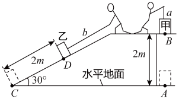

# Physics - 题目 1023

**ID**: 069885be79c14a0184aafba515f9369a
**年级**: Grade 9
**难度**: Medium-Hard
**题型**: Fill-in-the-blank

## 题目
如图，在10s内，小明用绳a把质量为10kg的物体甲从A点竖直向上匀速拉至B点；小红用绳b以平行于斜面的拉力把质量也为10kg的物体乙沿斜面从C点匀速拉至D点。​​​​​​​‌此过程中，斜面的机械效率为40%，A、B之间的高度差和C、D之间的距离都为2m，g=10N/kg。（1）甲的重力为N，此过程绳a对甲做的功W_{AB}=J；（2）此过程中，绳b对乙做的功为W_{CD}，请分析W_{AB}和W_{CD}的大小关系；()（3）此过程绳b对乙做功的功率P_{乙}=W。分析用该斜面拉物体乙能否省力。()

## 解答

1. （1）[1]由题知，m_{甲}=10kg，由G=mg得甲的重力为
2. G_{甲}=m_{甲}g=10kg×10N/kg=100N
3. 即甲的重力为100N。
4. [2]把物体甲从A点竖直向上匀速拉至B点，F_{a}=G_{甲}，物体上升的高度H=2m，绳a对甲做的功
5. WAB=F_{a}H=G_{甲}H=100N×2m=200J
6. 即绳a对甲做的功为200J。
7. （2）[3]用绳b以平行于斜面的拉力把质量也为10kg的物体乙沿斜面从C点匀速拉至D点，物体乙上升的高度
8. h=s_{CD}×sin30°=2m× $\frac {1}{2}$ =1m
9. 则绳b对乙做的有用功
10. W_{有用}=G_{乙}h=100N×1m=100J
11. 据η=40%，则绳b对乙做的总功
12. WCD= $\frac {W{{}_{有用}}}{40{\rm{\%}}}$ = $\frac {100{\rm{J}}}{40{\rm{\%}}}$ =250J
13. 故WAB和WCD的大小关系为：WAB<WCD。
14. （3）[4]此过程绳b对乙做功的功率
15. P= $\frac {W{{}_{CD}}}{t}$ = $\frac {250{\rm{J}}}{10{\rm{s}}}$ =25W
16. 绳b对乙做功的功率为25W。
17. [5]用该斜面拉物体乙的拉力
18. F_{b}= $\frac {W{{}_{CD}}}{s{{}_{CD}}}$ = $\frac {250{\rm{J}}}{2{\rm{m}}}$ =125N
19. 因此F_{b}>F_{a}，即不用该斜面拉物体乙不省力。

## 知识点

**中文**:
  - 功、功率、机械效率的综合计算
  - 有用功、额外功和总功的计算
  - 斜面的机械效率及其计算

**English**:
  - Comprehensive Calculation of Work, Power, and Efficiency
  - Calculation of Useful, Extra, and Total Work
  - Mechanical Efficiency of Inclined Planes and Calculations

---
