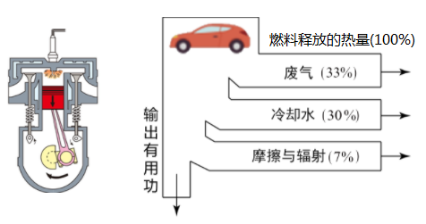

# Physics - 题目 2159

**ID**: 0a95b6bc152046089aef4407b10b3fec
**年级**: Grade 9
**难度**: Medium-Hard
**题型**: Fill-in-the-blank

## 题目
汽油属于（选填“清洁”或“非清洁”）能源。​​​​​​​‌如图是汽油机的冲程，一台四冲程汽油机每秒钟做功20次，则它的飞轮转速为r/min。某品牌汽车在某路段以1500N的恒定牵引力匀速行驶80km，牵引力做的功是J；汽车汽油机的能量流程图如图所示，则此次运行过程中需要完全燃烧kg的汽油。（汽油的热值为q＝5.0×10^{7}J/kg）

## 解答

1. [1]由于汽油燃烧后会产生污染大气的废气，所以汽油属于非清洁能源。
2. [2]由图可知，进气门和排气门都关闭，产生高温高压的燃气，高温高压气体推动活塞向下运动，带动曲轴转动，对外做功，属于做功冲程。
3. [3]四冲程汽油机每秒内对外做功20次，因为一个工作循环飞轮转2圈，完成4个冲程，做功1次，所以1s内，飞轮转40圈，1min飞轮转动的圈数为
4. 60×40圈=2400圈
5. [4]牵引力做的功
6. W=Fs=1500N×80×10^{3}m=1.2×10^{8}J
7. [5]由图知机械能的百分比
8. 100%-33%-30%-7%=30%
9. 完全燃烧质量为m的汽油产生的总能量
10. Q= ${\rm \frac {W}{η}=\frac {1.2\times 10{^{8}}{\rm{J}}}{30{\rm{\%}}}}$ =4×10^{8}J
11. 燃烧汽油的质量为
12. m= ${\rm \frac {Q}{q}=\frac {4\times 10{^{8}}{\rm{J}}}{5.0\times 10{^{7}}{\rm{J}}{\rm{/}}{\rm{k}}{\rm{g}}}}$ =8kg

## 知识点

**中文**:
  - 内燃机的四个冲程
  - 功的计算和估算
  - 热值及相关计算
  - 有关热机效率的计算
  - 能源的分类

**English**:
  - Four Strokes of Internal Combustion Engines
  - Calculation and Estimation of Work
  - Calorific Value and Calculations
  - Calculations of Heat Engine Efficiency
  - Classification of Energy Sources

---
