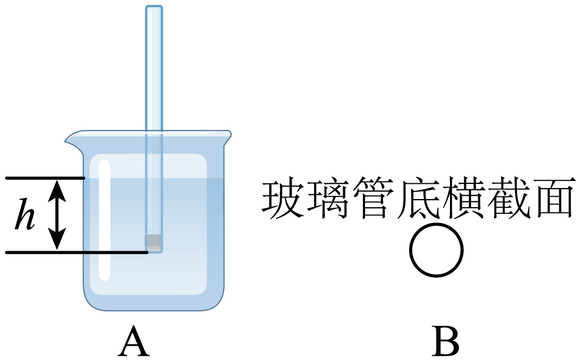

# Physics - 题目 1147

**ID**: 1b0ff4aecdf646cc811218bc0bb8d642
**年级**: Grade 9
**难度**: Medium-Hard
**题型**: Fill-in-the-blank

## 题目
安安同学在一段封闭、粗细均匀的玻璃管内装入适量的小铅丸，自制成一支密度计。​​​​​​​‌该密度计竖直漂浮在某液体中，如图甲所示。测出玻璃管和小铅丸的总质量为m，浸入液体中的玻璃管长为h，图B中玻璃管底面的直径（外直径）为d，则该液体的密度表达式ρ＝。

## 解答

1. 因为密度计竖直漂浮在液体中，根据物体的浮沉条件可知，密度计受到的浮力等于密度计自身的重力，则密度计受到的浮力为
2. F_{浮}=G=mg……①
3. 玻璃管底面的直径（外直径）为d，则玻璃管的底面积为
4. $S=πR{^{2}}=π{\left({\frac {d}{2}}\right)^{2}}=\frac {πd{^{2}}}{4}$
5. 密度计排开液体的体积等于密度计浸入液体中的体积，则密度计排开液体的体积为
6. $V{{}_{排}}=V{{}_{浸入}}=Sh=\frac {πd{^{2}}}{4}\cdot h=\frac {πd{^{2}}h}{4}$
7. 根据阿基米德原理可知，密度计受到浮力为
8. $F{{}_{浮}}{^{^{′}}}=ρgV=ρg\cdot \frac {πd{^{2}}h}{4}=\frac {ρgπd{^{2}}h}{4}$ ……②
9. 因浮力不变，故①=②，即
10. $mg=\frac {ρgπd{^{2}}h}{4}$
11. 解得液体的密度为 $ρ=\frac {4m}{πd{^{2}}h}$

## 知识点

**中文**:
  - 密度计的原理及应用

**English**:
  - Principle and Application of Hydrometer

---
