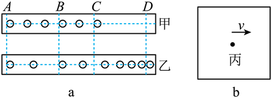

# Physics - 题目 658

**ID**: 20aec8f9de4c444fb932a21fa9c965a7
**年级**: Grade 9
**难度**: Medium-Hard
**题型**: Fill-in-the-blank

## 题目
冰壶和冰球运动是冬奥会比赛项目。​​​​​​​‌某次练习中，两运动员分别同时控制冰球甲、乙从A匀速直线向右滑行到B，水平推力大小相等。每经过1s，频闪摄影记录冰球的位置如图a，在B时撤去推力，两球分别静止在C和D处；（1）从A运动到B的过程中，甲、乙的速度v甲v乙（选填“>”、“=”或“>”），若以甲为参照物，乙（选填“向左运动”、“向右运动”或“静止”）；（2）从B运动到C的过程中，两冰球所受摩擦力f甲f乙（选填“>”、“=”或“>”）；（3）若乙冰球向右运动的过程中撞击静止的冰球丙，撞击力为F，撞击分离后丙向右运动；在图b方框内画出分离后丙运动过程中受到的力的示意图。（以表示丙）

## 解答

1. [2]因为甲的速度小于乙的速度，所以乙相对于甲向右运动，即以甲为参照物，乙向右运动。
2. （2）[3]因为两运动员分别同时控制冰球匀速运动时，水平推力大小相等，所以两球受到的滑动摩擦力大小相等，撤去推力后，两个冰球对冰面的压力，两个冰球和冰面的接触面粗糙程度不变，所以两个冰球所受到的摩擦力仍然相等。
3. （3）[4]两个冰球撞击分离后，冰球丙由于具有惯性将继续向前运动，最终在摩擦力的作用下停止运动，所以在水平方向上只受到摩擦力，竖直方向上有重力和支持力成一对平衡力，如下图所示
4. 

## 知识点

**中文**:
  - 摩擦力、平衡力和非平衡力作图
  - 运动和静止的相对性
  - 速度公式及其应用
  - 滑动摩擦力大小的影响因素

**English**:
  - Drawing Friction, Equilibrium, and Non-Equilibrium Forces
  - Relativity of Motion and Rest
  - Velocity Formula and Applications
  - Factors Affecting Sliding Friction

---
