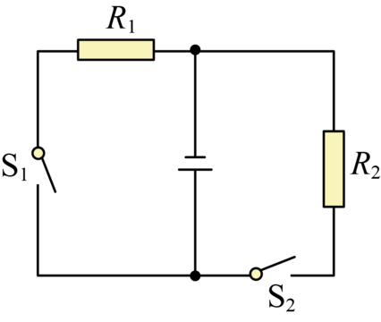
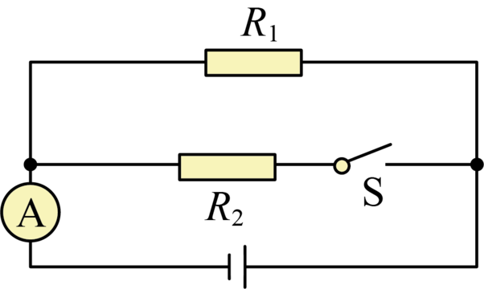
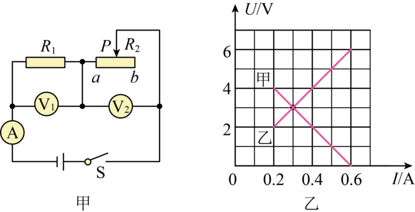

# Physics - 题目 2123

**ID**: 284f8d551cc6463cb63423fd621b50c2
**年级**: Grade 9
**难度**: Medium-Hard
**题型**: Fill-in-the-blank

## 题目
（1）如图所示的电路中，闭合开关S_{1}、S_{2}时，通过定值电阻R_{1}和R_{2}的电流之比是2∶5，则R_{1}和R_{2}的电阻之比为；此时R_{1}和R_{2}两端电压之比为；（2）如图，电源电压为6V，当开关S闭合时，电流表A的示数是0.8A，开关S断开时，电流表A的示数改变了0.5A，则R_{1}的阻值为Ω；（3）如图甲所示，电源电压不变，R_{1}是定值电阻，R_{2}是滑动变阻器。​​​​​​​‌当开关S闭合后，将滑动变阻器R_{2}的滑片从最右端移至最左端时，R_{1}和R_{2}的U-I关系图像如图乙所示。则a：电源电压为V；b：滑动变阻器的最大阻值为Ω；c：滑动变阻器的最大电功率是。

## 解答

1. （1）如图所示，开关闭合后，两电阻并联，根据并联电路电压的规律，电压之比为 $\frac {U{{}_{1}}}{U{{}_{2}}}=\frac {1}{1}$ ，根据欧姆定律可知R_{1}和R_{2}的电阻之比为 $\frac {R{{}_{1}}}{R{{}_{2}}}=\frac {I{{}_{2}}}{I{{}_{1}}}=\frac {5}{2}$ 。
2. （2）如图所示，闭合开关时，两电阻并联，电流表测干路电流，开关S断开时，电路为R_{1}的简单电路，电流表A的示数改变了0.5A，故R_{1}的电流为 $I{{}_{1}}=I-I{{}_{2}}=0.8{\rm{A}}-0.5{\rm{A}}=0.3{\rm{A}}$ ，则R_{1}的阻值为 $R{{}_{1}}=\frac {U}{I{{}_{1}}}=\frac {6{\rm{V}}}{0.3{\rm{A}}}=20Ω$ 。
3. （3）如图所示，V_{1}表测R_{1}两端电压，V_{2}表测R_{2}两端电压，根据电流与电压的关系可知，乙为R_{1}两端电流与电压的关系图像，甲为R_{2}两端电流与电压的关系图像，当滑动变阻器接入电阻为0时，R_{1}两端电压为电源电压为6V。电流为0.6A，R_{1}电阻为 $R{{}_{1}}=\frac {U}{I{{}_{1}}}=\frac {6{\rm{V}}}{0.6{\rm{A}}}=10Ω$ ，甲图中电流最小为0.2A时，滑动变阻器接入电阻最大，两端电压为4V，滑动变阻器的最大阻值为 $R{{}_{2}}=\frac {U{{}_{2}}}{I{{}_{2}}}=\frac {4{\rm{V}}}{0.2{\rm{A}}}=20Ω$ ，滑动变阻器的电功率 $P{{}_{2}}=I{^{2}}R{{}_{2}}=\left ({\frac {U}{R{{}_{1}}+R{{}_{2}}}}\right ){^{{^{2}}}}R{{}_{2}}=\frac {U{^{2}}}{\frac {{\left({R{{}_{1}}+R{{}_{2}}}\right)^{2}}}{R{{}_{2}}}}=\frac {U{^{2}}}{\frac {{\left({R{{}_{1}}-R{{}_{2}}}\right)^{2}}}{R{{}_{2}}}+4R{{}_{1}}}$ ，所以，当R_{2}＝R_{1}＝10Ω时，滑动变阻器的电功率最大，最大为 $P{{}_{滑{\rm{m}}{\rm{a}}{\rm{x}}}}=\frac {U{^{2}}}{4R{{}_{1}}}{\rm{=}}\frac {{\left({6{\rm{V}}}\right)^{2}}}{4\times 10{\rm{Ω}}}{\rm{=}}{{0}}{{.}}{{9}}{\rm{W}}$ 。

## 知识点

**中文**:
  - 并联电路的电流规律
  - 欧姆定律的应用
  - 电路的动态分析
  - 电功率的计算及应用

**English**:
  - Current Law in Parallel Circuits
  - Applications of Ohm's Law
  - Dynamic Circuit Analysis
  - Calculation and Application of Electric Power

---
