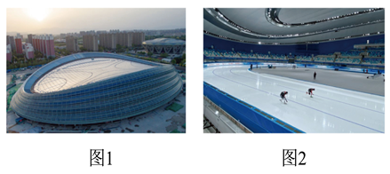

# Physics - 题目 131

**ID**: 3bae13bd11554132a5140d8657d14b84
**年级**: Grade 9
**难度**: Medium-Hard
**题型**: Fill-in-the-blank

## 题目
请阅读《“冰丝带”——国家速滑馆》回答问题。​​​​​​​‌“冰丝带”——国家速滑馆国家速滑馆（如图1所示），它有一个晶莹美丽的呢称——“冰丝带”。场馆的曲面幕墙系统，由3360块曲面玻璃单元拼装而成，打造出象征速滑运动员高速滑动的“丝带”造型。国家速滑馆是2022年北京冬奥会北京主赛区标志性场馆，也是唯一新建的冰上竞赛场馆。馆内拥有亚洲最大的冰面，面积达1.2万平方米。其中包括3条400米速滑比赛道、1条速滑比赛练习道、2块多功能冰场及1块活动冰场（如图2所示）。国家速滑馆力求打造出世界上平原地区“最快的冰”。要想提高在冰面上滑行的速度，冰面要平整，冰温要均匀，是必不可少的条件。工人师傅们制出的混凝土冰板层水平高差在4毫米左右，非常平整。制冰时，混凝土冰板层下方总长约为130km的管道内输入的是低温的液态二氧化碳。液态二氧化碳在管道中直接蒸发，使混凝土冰板层的温度降低到零下十几摄氏度，通过洒水作业，冻成厚度为几毫米的冰面，经过很多次这样的工序，厚度几十毫米的冰面才能冻结成功。冰面温差被控制在0.5℃以内，有利于运动员创造好成绩。不同冰面可进行分区制冷，对每块冰面单独控温，实现场馆“同时运行、不同使用”。场馆制冰系统集成设计和冰板结构设计两个关键设计方案已取得专利。二氧化碳制冷剂是环保性最好的冷媒之一，碳排放值趋近于零。同时，二氧化碳跨临界直接蒸发制冷过程中排出的余热还可以回收再利用，满足观众席供暖、运动员生活热水、融冰池融冰、冰面维护浇冰等能源需求，冷热综合利用能效比较高，国家速滑馆是一个绿色环保、节能型场馆。请根据上述材料，回答下列问题：（1）要想提高运动员在冰面上滑行的速度，对冰面和冰温的要求是。在标准大气压下，冰水混合物的温度是℃，水的沸点是℃；（2）制冰时，使冰板混凝土温度下降的原因是。二氧化碳液化过程热量，干冰（固态二氧化碳）升华过程吸收热量。（后两项均选填“吸收”或“放出”）。

## 解答

1. [2][3]物理学中规定，一标准大气压下，冰水混合物的温度是0℃，水的沸点是100℃。
2. （2）[4]根据题意，制冰时，使冰板混凝土温度下降的原因是：液态二氧化碳蒸发吸热，有致冷作用。
3. [5][6]物质从气态变为液态叫液化，液化是放热过程；物质从固态直接变为气态叫升华，升华是吸热过程。二氧化碳液化过程放出热量，干冰（固态二氧化碳）升华过程吸收热量。

## 知识点

**中文**:
  - 常见的温度
  - 物态变化及其吸放热情况的判断与应用

**English**:
  - Common Temperatures
  - Judgment and Application of State Changes and Heat Transfer

---
