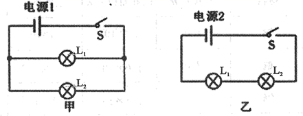

# Physics - 题目 1541

**ID**: 3d5d7ab62da940ddb3451d2b5b722510
**年级**: Grade 9
**难度**: Medium-Hard
**题型**: Fill-in-the-blank

## 题目
有“6V  6W”的 ${\rm{L}}{{}_{{\rm{1}}}}$ 灯泡和：6V  3W”的 ${\rm{L}}{{}_{{\rm{2}}}}$ 灯泡，如图甲所示，闭合开关， ${\rm{L}}{{}_{{\rm{1}}}}$ 灯泡和 ${\rm{L}}{{}_{{\rm{2}}}}$ 正常发光，则干路总电流 $I=$A；如图乙所示，闭合开关，使其中一个灯正常发光，另一个灯不损坏，则电源2的电压 $U=$V；此时 ${\rm{L}}{{}_{{\rm{1}}}}$ 消耗的实际功率 $P=$W（假设灯丝电阻不变）。​​​​​​​‌

## 解答

1. 灯泡 ${\rm{L}}{{}_{{\rm{1}}}}$ 的电阻
2. $R{{}_{1}}=\frac {U{{}_{1}^{2}}}{P{{}_{1}}}=\frac {{\rm{(}}{\rm{6}}{\rm{V}}{\rm{)}}{^{{\rm{2}}}}}{{\rm{6}}{\rm{W}}}=6{\rm{Ω}}$
3. 灯泡L_{2}的电阻
4. $R{{}_{2}}=\frac {U{^{2}}}{P{{}_{2}}}=\frac {{\rm{(}}{\rm{6}}{\rm{V}}{\rm{)}}{^{{\rm{2}}}}}{{\rm{3}}{\rm{W}}}=12{\rm{Ω}}$
5. 由图甲可知，两灯泡并联，
6. $R=\frac {R{{}_{1}}R{{}_{2}}}{R{{}_{1}}+R{{}_{2}}}=\frac {{\rm{6}}{\rm{Ω}}\times 12{\rm{Ω}}}{6{\rm{Ω}}+12{\rm{Ω}}}=4{\rm{Ω}}$
7. 干路总电流
8. $I=\frac {U}{R}=\frac {{\rm{6}}{\rm{V}}}{4{\rm{Ω}}}=1.5{\rm{A}}$
9. 灯泡 ${\rm{L}}{{}_{{\rm{1}}}}$ 的正常发光电流为
10. $I{{}_{1}}=\frac {U}{R{{}_{1}}}=\frac {{\rm{6}}{\rm{V}}}{{\rm{6}}{\rm{Ω}}}=1{\rm{A}}$
11. 灯泡L_{2}的正常发光电流为
12. $I{{}_{2}}=\frac {U}{R{{}_{2}}}=\frac {{\rm{6}}{\rm{V}}}{{\rm{1}}{\rm{2}}{\rm{Ω}}}=0.5{\rm{A}}$
13. 由图乙知，两灯串联在电路中，只有一灯正常发光，则一定是L_{2}，此时电路中的电流为0.5A，则电源2的电压
14. $U=I{{}_{1}}(R{{}_{1}}+R{{}_{2}})=0.5{\rm{A}}\times (6{\rm{Ω}}+12{\rm{Ω}}）=9{\rm{V}}$
15. 此时 ${\rm{L}}{{}_{{\rm{1}}}}$ 消耗的实际功率
16. $P{{}_{1}^{^{′}}}=I{{}_{2}^{2}}R{{}_{1}}=(0.5{\rm{A}}){^{2}}\times 6{\rm{Ω}}{\rm{=}}{\rm{1}}{\rm{.}}{\rm{5}}{\rm{W}}$

## 知识点

**中文**:
  - 串、并联电路中的电功率
  - 欧姆定律的应用
  - 电功率的计算及应用
  - 实际电压与实际功率

**English**:
  - Electric Power in Series/Parallel Circuits
  - Applications of Ohm's Law
  - Calculation and Application of Electric Power
  - Actual Voltage and Actual Power

---
