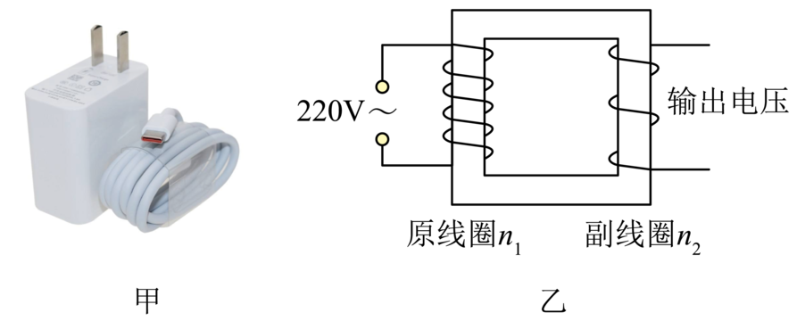

# Physics - 题目 2212

**ID**: 51b2558eebe54752a952f3c447a66196
**年级**: Grade 9
**难度**: Medium-Hard
**题型**: Fill-in-the-blank

## 题目
小明发现爸爸给手机充电时，不到十分钟可把电池充达一半以上，查阅资料得知，原来该手机搭配了超级快充功能，已知该手机电池的部分参数如下表所示，如图甲所示为该手机充电器，通过阅读说明书，小明还知道了原来在充电器的内部存在降压变压器使充电器输出电压为4.4V。​​​​​​​‌可将变压器原理简化为如图乙：原线圈匝数n1，副线圈匝数n2，若输入电压U1，输出电压U2，则电压与匝数关系式为： $\frac {U{{}_{1}}}{U{{}_{2}}}=\frac {n{{}_{1}}}{n{{}_{2}}}$ 。电池名称锂离子电池电压3.7V容量4400mAh（1）充电器为手机电池充电时，将能转化为能；（2）若原线圈的匝数为1100圈，要使充电器的输出电压为4.4V，副线圈匝数为圈；（3）小明发现超级快充的充电线比普通手机充电线要粗一些，请你从线路安全的角度来分析是因为；（4）此款电池充满电储存的电能为J；（5）如果不考虑快充时的电能损耗，用一个标注“输出4.4V，10A”的快速充电器把这款手机电池从电量0%充到100%，需要的时间是s。

## 解答

1. （1）[1][2]给手机电池充电时消耗电能，产生手机电池的化学能，故是将电能转化为化学能的过程。
2. （2）[3]若原线圈的匝数为1100圈，要使充电器的输出电压为4.4V，由
3. ${\rm \frac {U{{}_{1}}}{U{{}_{2}}}=\frac {n{{}_{1}}}{n{{}_{2}}}}$
4. 可知副线圈匝数为
5. ${\rm n{{}_{2}}=\frac {U{{}_{2}}n{{}_{1}}}{U{{}_{1}}}=\frac {4.4{\rm{V}}\times 1100圈}{220{\rm{V}}}=22圈}$
6. （3）[4]充电线尽可能做得粗一些，目的是减小电阻，使充电过程中产生的热量少一些。
7. （4）[5]电池充满电储存的电能为
8. W=UIt=3.7V×4400×10-3A×1×3600s=58608J
9. （5）[6]快充时消耗的电能等于手机电池的容量，则快充时消耗的电能
10. W′=W=58608J
11. 快充功率
12. P=UI=4.4V×10A=44W
13. 快充需要的时间
14. ${\rm t=\frac {W{^{\prime }}}{P}=\frac {{\rm{5}}{\rm{8}}{\rm{6}}{\rm{0}}{\rm{8}}{\rm{J}}}{{\rm{4}}{\rm{4}}{\rm{W}}}{\rm{=}}{\rm{1}}{\rm{3}}{\rm{3}}{\rm{2}}{\rm{s}}}$

## 知识点

**中文**:
  - 焦耳定律的计算公式及其应用
  - 能量的转化
  - 电功与电能的计算
  - 电功率的计算及应用

**English**:
  - Formula and Application of Joule's Law
  - Transformation of Energy
  - Calculation of Electric Work and Energy
  - Calculation and Application of Electric Power

---
