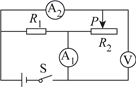

# Physics - 题目 2699

**ID**: 552f57be8d7e4bed9d0c877ea412e868
**年级**: Grade 9
**难度**: Medium-Hard
**题型**: Fill-in-the-blank

## 题目
如图所示的电路中，电源电压保持不变，其中定值电阻R_{1}的阻值为R_{0}，滑动变阻器R_{2}的最大阻值为2R_{0}，闭合电键S，当滑动变阻器的滑片P从中点向右移动时，电压表V与电流表A_{1}示数的比值将（选填“变大”、“变小”或“不变”），电流表A_{1}示数与A_{2}示数之比的最小值为。​​​​​​​‌

## 解答

1. 由电路图可知，R_{1}与R_{2}并联，电压表测电源的电压，电流表A_{1}测干路电流，电流表A_{2}测R_{2}支路的电流。
2. [1]因电源的电压保持不变，所以滑片移动时，电压表的示数V不变；因并联电路中各支路独立工作、互不影响，所以，滑片移动时，通过R_{1}的电流不变，当滑动变阻器的滑片P从中点向右移动时，接入电路中的电阻变大，由 $I=\frac {U}{R}$ 可知，通过R_{2}的电流变小，即电流表A_{2}的示数变小，因并联电路中干路电流等于各支路电流之和，所以干路电流变小，即电流表A_{1}的示数变小，则电压表V与电流表A_{1}示数的比值变大。
3. [2]电流表A_{1}示数与A_{2}示数之比
4. $\frac {I{{}_{{\rm{A}}{\rm{1}}}}}{I{{}_{{\rm{A}}{\rm{2}}}}}=\frac {I{{}_{1}}+I{{}_{2}}}{I{{}_{1}}}=\frac {I{{}_{1}}}{I{{}_{2}}}+1$
5. 因通过R_{1}的电流I_{1}不变，所以当I_{2}最大时，电流表A_{1}示数与A_{2}示数之比最小，当滑动变阻器的滑片P从中点向右移动时，接入电路中的最小阻值为 $\frac {R{{}_{2}}}{2}$ ，则电流表A_{1}示数与A_{2}最小示数之比
6. $\frac {I{{}_{1}}}{I{{}_{2}}}+1=\frac {\frac {U}{R{{}_{1}}}}{\frac {U}{\frac {R{{}_{2}}}{2}}}+1=\frac {R{{}_{2}}}{2R{{}_{1}}}+1=\frac {2R{{}_{0}}}{2R{{}_{0}}}+1=2$

## 知识点

**中文**:
  - 并联电路的电流规律
  - 欧姆定律的应用
  - 电路的动态分析

**English**:
  - Current Law in Parallel Circuits
  - Applications of Ohm's Law
  - Dynamic Circuit Analysis

---
