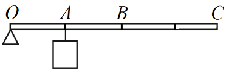

# Physics - 题目 2052

**ID**: 5610b8fe333749eab78ebb4808cc4977
**年级**: Grade 9
**难度**: Medium-Hard
**题型**: Fill-in-the-blank

## 题目
如图所示，一根均匀的细木棒OC， $OA=\frac {1}{4}OC$ ，B为OC的中点。​​​​​​​‌在C点用始终竖直向上的50N的拉力将挂在A点的重为180N的物体匀速提升0.1m。提升该物体做的有用功是J，总功是J，木棒的机械效率为，木棒重为N（不计摩擦），如果将拉力从C点移动至B点，则机械效率会（增加、不变或减小）。

## 解答

1. [1][2][3][4][5]提升该物体做的有用功
2. $W{{}_{有用}}=Gh={\rm{1}}{\rm{8}}{\rm{0}}{\rm{N}}\times {\rm{0}}{\rm{.}}{\rm{1}}{\rm{m}}{\rm{=}}{\rm{1}}{\rm{8}}{\rm{J}}$
3. 因为 $OA=\frac {1}{4}OC$  所以
4. $s=4h={\rm{0}}{\rm{.}}{\rm{1}}{\rm{m}}\times {\rm{4}}{\rm{=}}{\rm{0}}{\rm{.}}{\rm{4}}{\rm{m}}$
5. 提升该物体做的总功
6. $W{{}_{总}}=Fs={\rm{5}}{\rm{0}}{\rm{N}}\times {\rm{0}}{\rm{.}}{\rm{4}}{\rm{m}}{\rm{=}}{\rm{2}}{\rm{0}}{\rm{J}}$
7. 由
8. $η=\frac {W{{}_{有}}}{W{{}_{总}}}\times 100\%=\frac {{\rm{1}}{\rm{8}}{\rm{J}}}{{\rm{2}}{\rm{0}}{\rm{J}}}\times {\rm{1}}{\rm{0}}{\rm{0}}{\rm{\%}}{\rm{=}}{\rm{9}}{\rm{0}}{\rm{\%}}$
9. 因为W_{总}=W_{有用}+W_{额}，所以，克服木棒重力做的额外功
10. $W{{}_{额}}=W{{}_{总}}-W{{}_{有用}}={\rm{2}}{\rm{0}}{\rm{J}}{\rm{-}}{\rm{1}}{\rm{8}}{\rm{J}}{\rm{=}}{\rm{2}}{\rm{J}}$
11. 因为 $OA=\frac {1}{4}OC$  ，B为OC的中点，所以OB= 2OA，所以，由相似三角形的知识可知，当物体上升0.1m时，B点(重心)将上升h'=0.2m，不计摩擦和绳子重，由W_{额}=G_{木}h'可得木棒重
12. $G{{}_{木}}=\frac {W{{}_{额}}}{h{^{\prime }}}=\frac {{\rm{2}}{\rm{J}}}{{\rm{0}}{\rm{.}}{\rm{2}}{\rm{m}}}{\rm{=}}{\rm{1}}{\rm{0}}{\rm{N}}$
13. 不计摩擦，如果将拉力从C点移动至B点，提高相同的高度，有用功不变，总功减小，机械效率将增加。

## 知识点

**中文**:
  - 有用功、额外功和总功的计算
  - 杠杆的机械效率及其计算

**English**:
  - Calculation of Useful, Extra, and Total Work
  - Mechanical Efficiency of Levers and Calculations

---
