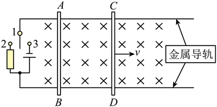

# Physics - 题目 1020

**ID**: 58a1765516c44bc5a60bba9d0eab4294
**年级**: Grade 9
**难度**: Medium-Hard
**题型**: Fill-in-the-blank

## 题目
如图所示，水平放置的两光滑金属导轨与电路连接并置于垂直于导轨向里的匀强磁场（磁场强弱和方向处处相同）中，两根相同的金属棒AB、CD与导轨紧密接触且可自由滑动，导轨足够长，AB、CD电阻均为R。​​​​​​​‌（1）固定金属棒AB，把双向开关接到接线柱2，使金属棒CD水平向右运动，此时金属棒AB中有从A流向B的电流；若使金属棒CD水平向左运动，则此时金属棒AB中（选填“有”或“没有”）电流；请判断电流的方向；（选填“从A流向B”或“从B流向A”）（2）固定金属棒AB，把双向开关接到接线柱3，金属棒CD受到水平向左的磁场力作用，此时金属棒AB（选填“有”或“没有”）受到磁场力；该磁场力的方向（选填“水平向左”或“水平向右”）。如果要改变金属棒AB中的受力方向，需要的实验步骤是：。

## 解答

1. （2）[3][4]固定金属棒AB，把双向开关接到接线柱3，金属棒CD受到水平向左的磁场力作用，通电导体在磁场中会受到力的作用，此时金属棒AB受到磁场力，且两金属棒中电流方向相同，金属棒AB与金属棒CD受到的力的方向相同，都是水平向左。
2. [5]金属棒受力的方向与磁场方向和电流方向有关，如果要改变金属棒AB中的受力方向，可以对换电源正负极或改变磁场方向。

## 知识点

**中文**:
  - 产生感应电流的条件
  - 磁场对通电导线的作用

**English**:
  - Conditions for Induced Current
  - Effect of Magnetic Field on Energized Wire

---
