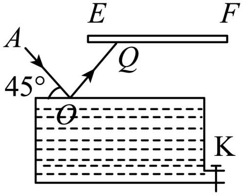

# Physics - 题目 888

**ID**: 5d42ebbc263e44eba48d82ac9be8eb99
**年级**: Grade 9
**难度**: Medium-Hard
**题型**: Fill-in-the-blank

## 题目
如图所示，底面积为1m^{2}的圆柱形容器装满水，一光束沿AO射向水面，方向保持不变，反射光线在水平光屏EF上形成光点Q，打开水阀K，水流出，水位下降，光点在光屏上向移动，当光点移了10cm时，入射角（选填“变大”、“变小”或“不变”），容器中的水已流出kg（ρ_{水}=1×10^{3}kg/m^{3}）。​​​​​​​‌

## 解答

1. 根据光的反射规律，作出液面下降后，光的反射光路图。入射光线AO射到水面，水面将光线反射到Q点，反射光OQ和入射光AO满足反射定律，入射角为45°，反射角也为45°；当水面下降时，入射光线AO保持不变，入射点将随着水面下降而移到O′，M为法线O'M与原来界面的交点，如下图，由于入射光AO没变，入射角也没变，故反射角也不变，仍为45°，则在O′点反射的光线O′Q′∥OQ右移，O′Q′与原来的水面交于P点，如图：
2. 
3. 根据几何关系，QQ′∥OP，OQ∥PQ′，四边形OPQ′Q为平行四边形，所以OP=QQ′，因为入射角为45°，所以∠OO'M=45°，O'M为法线垂直于界面，由光的反射定律可知，反射角∠PO'M=45°，所以△OO′P、△O′MP都是等腰直角三角形，则 $O\prime M=MP=\frac {1}{2}OP$ ，所以当光斑在EF上向右移动s=QQ'=OP=10cm，水面将下降 $h=O\prime M=\frac {1}{2}s=\frac {1}{2}\times 10{\rm{c}}{\rm{m}}=5{\rm{c}}{\rm{m}}=0.05{\rm{m}}$ ，
4. 由 $ρ=\frac {m}{V}$ 得，流出水的质量m_{水}=ρ_{水}V_{水}=ρ_{水}Sh=1.0×10^{3}kg/m^{3}×1m^{2}×0.05m=50kg。

## 知识点

**中文**:
  - 光的反射定律及其应用
  - 密度公式的应用

**English**:
  - Law of Reflection and Applications
  - Application of Density Formula

---
