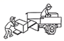

# Physics - 题目 40

**ID**: 5f761ad74abe4665b91238051a8ac855
**年级**: Grade 9
**难度**: Medium-Hard
**题型**: Fill-in-the-blank

## 题目
往车上装重物时，常常用长木板搭个斜面，把重物沿斜面推上去，如图所示。​​​​​​​‌工人用3m长的斜面，把1200N的重物提高1m。假设斜面很光滑，则需要施加的推力为；若实际用力为500N，则斜面的机械效率为，推重物时，重物受到的摩擦力为。

## 解答

1. 斜面很光滑，则额外功为0，沿斜面推力做的功等于直接提升对物体做的功，所以此时推力做的功
2. W＝Fs＝Gh＝1200N×1m＝1200J
3. 施加的推力
4. $F=\frac {W}{s}=\frac {{\rm{1}}{\rm{2}}{\rm{0}}{\rm{0}}{\rm{J}}}{{\rm{3}}{\rm{m}}}{\rm{=}}{\rm{4}}{\rm{0}}{\rm{0}}{\rm{N}}$
5. 实际存在摩擦力，推力做的总功
6. W_{总}＝F′s＝500N×3m＝1500J
7. 有用功
8. W_{有用}＝W＝1200J
9. 斜面的机械效率
10. $η=\frac {W{{}_{有用}}}{W{{}_{总}}}\times 100\%=\frac {1200J}{1500J}\times 100\%=80\%$
11. 额外功为
12. W_{额}＝W_{总}﹣W_{有}＝1500J﹣1200J＝300J
13. 由W_{额}＝fs得摩擦力
14. $f=\frac {W{{}_{额}}}{s}=\frac {300{\rm{J}}}{3{\rm{m}}}=100{\rm{N}}$

## 知识点

**中文**:
  - 斜面的机械效率及其计算
  - 滑动摩擦力的大小
  - 有用功、额外功和总功的计算

**English**:
  - Mechanical Efficiency of Inclined Planes and Calculations
  - Magnitude of Sliding Friction
  - Calculation of Useful, Extra, and Total Work

---
