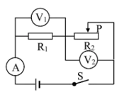

# Physics - 题目 2310

**ID**: 634d72229b25402a8e58b8074397e0fc
**年级**: Grade 9
**难度**: Medium-Hard
**题型**: Fill-in-the-blank

## 题目
在图所示的电路中，电源电压保持不变，闭合电键S（已知电阻 $R{{}_{1}}$ 、滑动变阻器 $R{{}_{2}}$ 中仅有一个出现了故障）；①若发现三个电表中有一个电表无示数，电路中的故障可能是；若发现三个电表中有两个电表无示数，电路中的故障可能是。​​​​​​​‌②接着继续观察发现V_{1}无示数，A、V_{2}有示数，且移动变阻器 $R{{}_{2}}$ 的滑片P；若电流表的示数发生了改变，则故障一定是；若电压表V_{2}的示数不变，则故障一定是。

## 解答

1. [1][2]假设R_{1}断路，那么电流表没有示数，电压表V_{1}测的是电源电压，电压表V_{2}没有示数；假设R_{1}短路，那么有电流流过R_{2}，电流表有示数，电压表V_{1}没有示数，电压表V_{2}有示数；假设R_{2}断路，那么电流表没有示数，电压表V_{1}没有示数，电压表V_{2}测的是电源电压；假设R_{2}短路，那么有电流流过R_{1}，电流表有示数，电压表V_{2}没有示数，电压表V_{1}有示数；综上所述，若发现三个电表中有一个电表无示数，电路中的故障可能是R_{1}短路或者R_{2}短路；若发现三个电表中有两个电表无示数，电路中的故障可能是R_{1}断路或者R_{2}断路；
2. [3]假设R_{2}短路，电流表的示数是 $I{{}_{1}}=\frac {U}{R{{}_{1}}}$ ，移动变阻器 $R{{}_{2}}$ 的滑片P，R_{1}的电阻和电压大小都不变，那么电流表的示数也不变，这与条件不符合，所以不是R_{2}短路，应该是R_{1}短路；
3. [4]假设R_{2}短路，电流表的示数是 $I{{}_{1}}=\frac {U}{R{{}_{1}}}$ ，移动变阻器 $R{{}_{2}}$ 的滑片P，R_{1}的电阻不变化，电流也不变化，电压表V_{2}的示数不变，为零，电压表V_{1}的示数也不变，这与题意V_{2}有示数不符合，所以不可能是R_{2}短路，只能是R_{1}短路。

## 知识点

**中文**:
  - 电流表、电压表在判断电路故障中的应用

**English**:
  - Using Meters to Diagnose Circuit Faults

---
