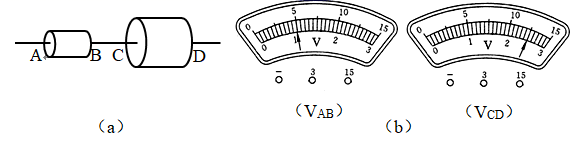

# Physics - 题目 1747

**ID**: 66c338e358074998bde0d12d9580b4e6
**年级**: Grade 9
**难度**: Medium-Hard
**题型**: Fill-in-the-blank

## 题目
如图（a）所示，长度相同、粗细不同的同种金属棒AB和CD串联在电路中。​​​​​​​‌则通过AB的电流通过CD的电流（选填“大于”、“等于”或“小于”）。用电压表测得AB和CD两端的电压如图（b）所示，则AB两端的电压为伏，CD两端电压为伏.

## 解答

1. [1]根据串联电路电流处处相等可知，通过AB的电流等于通过CD的电流；
2. [2][3]根据 $R=ρ\frac {L}{S}$ 可知，金属棒AB和CD是同种材料，长度相同，但是CD的横截面积比较大，那么CD的电阻较小，根据 $U=IR$ 可知，CD的电压较小，AB的电压较大，假设AB两端的电压表量程是0到3V，那么它的读数是1V，而CD两端的电压表量程无论是0到3V还是0到15V，读数都大于AB两端的电压，这种情况不合题意；所以AB两端的电压表量程应该是0到15V，那么它的读数是5V；假设CD两端的电压表量程是0到15V，那么它的读数是12.5V，这个读数大于AB两端的电压，这种情况不合题意，所以CD两端的电压表量程应该是0到3V，那么它的读数是2.5V。

## 知识点

**中文**:
  - 串联电路的电流规律
  - 电压表的读数
  - 欧姆定律的应用

**English**:
  - Current Law in Series Circuits
  - Reading a Voltmeter
  - Applications of Ohm's Law

---
