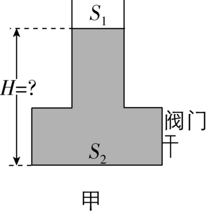
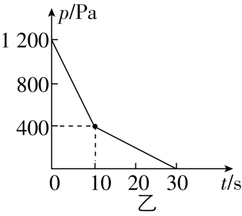

# Physics - 题目 2613

**ID**: 6826821be9b9433ba17bd3309db1a7c2
**年级**: Grade 9
**难度**: Medium-Hard
**题型**: Fill-in-the-blank

## 题目
如图甲所示的容器放置在水平地面上，该容器上、下两部分都是圆柱体，其横截面积分别为S_{1}、S_{2}，容器底部装有控制阀门。​​​​​​​‌容器内装有密度为0.8×10^{3}kg/m^{3}的液体，液体通过控制阀门匀速排出的过程中，容器底部受到液体的压强p随时间t变化关系如图乙所示。则阀门打开前液体的深度H＝cm，上、下两部分横截面积之比S_{1}∶S_{2}＝。(g取10 N/kg)

## 解答

1. 由乙图可知，当t＝0 s时，p＝1 200 Pa，由p＝ρgh可得，阀门打开前液体的深度：H＝ $\frac{p}{\rho g}$ ＝ $\frac{1200Pa}{0.8×{10}^{3}kg/{m}^{3}×10N/kg}$ ＝0.15 m＝15 cm；设容器上面部分液体的高度为h_{1}，h_{1}对应的液体压强p_{1}＝1 200 Pa－400 Pa＝800 Pa，则h_{1}＝ $\frac{{p}_{1}}{\rho g}$ ＝ $\frac{800Pa}{0.8×{10}^{3}kg/{m}^{3}×10N/kg}$ ＝0.1 m＝10 cm，所以容器下面部分液体的高度为h_{2}＝H－h_{1}＝15 cm－10 cm＝5 cm；由于匀速排液，则后20 s排出液体的体积是前10 s排出液体体积的2倍，由V＝Sh可得，上、下两部分液体的体积关系为：2S_{1}h_{1}＝S_{2}h_{2}，则上、下两部分的横截面积之比为： $\frac{{S}_{1}}{{S}_{2}}$ ＝ $\frac{{h}_{2}}{2{h}_{1}}$ ＝ $\frac{5cm}{2×10cm}$ ＝ $\frac{1}{4}$ 。

## 知识点

**中文**:
  - 液体压强的判断与计算

**English**:
  - Determination and Calculation of Liquid Pressure

---
