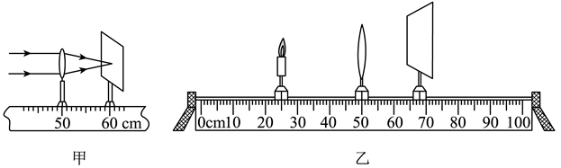

# Physics - 题目 150

**ID**: 8e6c60cc31844a51bdc1d0fd428d2e30
**年级**: Grade 9
**难度**: Medium-Hard
**题型**: Fill-in-the-blank

## 题目
如图甲所示，一束平行光经过凸透镜后，在光屏上得到一个最小、最亮的光斑，则它的焦距是cm；用此凸透镜探究成像规律，实验装置如图乙所示，调整后在光屏上得到一个清晰的倒立实像（选填“放大”或“缩小”）；此时乐乐同学将爷爷的老花眼镜放在蜡烛和凸透镜之间，结果光屏上原来清晰的像变模糊了，若不改变蜡烛和凸透镜的位置，应将光屏向（选填“远离”或“靠近”）凸透镜方向移动，才能使像变得清晰。​​​​​​​‌

## 解答

1. [2]由乙图可知，物距u=25cm>2f，根据凸透镜成像规律可知，此时光屏上成倒立、缩小的实像。
2. [3]老花眼镜是由凸透镜制成的，当把老花眼镜放在蜡烛和凸透镜之间时，由于凸透镜对光有会聚作用，所以像将成在光屏前方，若不改变蜡烛和凸透镜的位置，应将光屏向靠近凸透镜方向移动，才能使像变得清晰。

## 知识点

**中文**:
  - 凸透镜成像规律的动态变化问题
  - 凸透镜成像规律的应用
  - 远视眼的成因与矫正办法

**English**:
  - Dynamic Changes in Convex Lens Imaging
  - Applications of Convex Lens Imaging
  - Causes and Correction of Hyperopia (Farsightedness)

---
