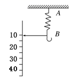

# Physics - 题目 1344

**ID**: 93206e3f34694ffb8c4d370281d504ba
**年级**: Grade 9
**难度**: Medium-Hard
**题型**: Fill-in-the-blank

## 题目
如图所示，一根弹簧的自由端B在未悬挂重物时，正对刻度10，挂上100N重物时，正对刻度30；当弹簧挂50N重物时，自由端所对刻度应是；若自由端所对刻度是18，这时弹簧下端悬挂的重物为N。​​​​​​​‌

## 解答

1. [1]挂上100N重物时弹簧的拉力F_{1}=100N，伸长量
2. $\Delta L{{}_{1}}=30-10=20$
3. 当挂50N重物时，拉力为F_{2}=50N，因为在弹性限度内，弹簧的伸长与拉力成正比，所以
4. $ \frac {F{{}_{1}}}{\Delta L{{}_{1}}}=\frac {F{{}_{2}}}{\Delta L{{}_{2}}}$
5. 即
6. $ \frac {{\rm{1}}{\rm{0}}{\rm{0}}{\rm{N}}}{{\rm{2}}{\rm{0}}}=\frac {50{\rm{N}}}{\Delta L{{}_{2}}}$
7. 解得 $\Delta L{{}_{2}}=10$ ，自由端所对刻度为
8. $10+10=20$
9. [2]若自由端所对刻线是18，弹簧伸长量
10. $\Delta L{{}_{3}}=18-10=8$
11. 因为在弹性限度内，弹簧的伸长与拉力成正比，所以
12. $ \frac {F{{}_{1}}}{\Delta L{{}_{1}}}=\frac {F{{}_{3}}}{\Delta L{{}_{3}}}$
13. 即
14. $ \frac {100{\rm{N}}}{20}=\frac {F{{}_{3}}}{8}$
15. 解得F_{3}=40N，弹簧下端悬挂的重物
16. $G=F{{}_{3}}=40{\rm{N}}$
17. 这时弹簧下端悬挂的重物为40N。

## 知识点

**中文**:
  - 探究弹簧测力计原理的实验

**English**:
  - Experiment: Principle of Spring Dynamometer

---
