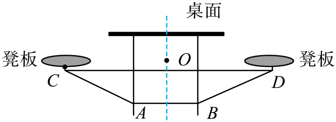

# Physics - 题目 30

**ID**: 957e602005a84addbdfc0171a94e2fc1
**年级**: Grade 9
**难度**: Medium-Hard
**题型**: Fill-in-the-blank

## 题目
学校食堂准备采购一批餐桌，在试坐一款一体式餐桌时，瘦小的小王一坐上凳板时就发生了倾倒，为研究其原因，他和同学们一起进行了测试，发现在凳板上放上25kg的物体时，餐桌的另一头就刚好翘起，同时测量到AB间的距离为50cm，CD间的距离为140cm，桌面距离地面70cm，AC、BD为桌脚和凳板的连接杆。​​​​​​​‌若物体放在C处，餐桌翘起时，支点是（A/B）。若不计凳板的质量，餐桌的质量为kg；为防止倾倒，请你给厂方提出一条可行的建议：。

## 解答

1. 由图可知，若物体放在C处，餐桌翘起时，绕A点转动，根据支点的定义可知，A点为支点；
2. 由图可知，一体式餐桌左右对称，因此餐桌重心在对称轴上，假设物体放在左侧凳板C上，此时作用在餐桌上的力和对应的力臂如图所示
3. 
4. 由图可知 $L{{}_{1}}=\frac {1}{2}CD-\frac {1}{2}AB=\frac {1}{2}\times 140{\rm{c}}{\rm{m}}-\frac {1}{2}\times 50{\rm{c}}{\rm{m}}=45{\rm{c}}{\rm{m}}$ ， $L{{}_{2}}=\frac {1}{2}AB=\frac {1}{2}\times 50{\rm{c}}{\rm{m}}=25{\rm{c}}{\rm{m}}$ ，由杠杆平衡可知 $G{{}_{物}}\times L{{}_{1}}=G{{}_{桌}}\times L{{}_{2}}$ ，即 $m{{}_{物}}g\times L{{}_{1}}=桌\times L{{}_{2}}$ ，则桌的质量 $m{{}_{桌}}=\frac {L{{}_{1}}}{L{{}_{2}}}\times m{{}_{物}}=\frac {45{\rm{c}}{\rm{m}}}{25{\rm{c}}{\rm{m}}}\times 25{\rm{k}}{\rm{g}}=45{\rm{k}}{\rm{g}}$ ，由杠杆平衡条件可知，物体的重力和餐桌的重力一定时，通过减小凳板侧物体重力的力臂、增加餐桌重力的力臂可以防止餐桌倾倒，因此可以增大AB间的距离，同时适当减小CD间的距离或增加餐桌自身的重力。

## 知识点

**中文**:
  - 杠杆及其五要素
  - 杠杆平衡条件的应用

**English**:
  - Levers and their Five Elements
  - Application of Lever Equilibrium Conditions

---
