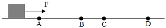

# Physics - 题目 316

**ID**: 9777842b1cb54c188e573326f1f7a704
**年级**: Grade 9
**难度**: Medium-Hard
**题型**: Fill-in-the-blank

## 题目
物块在水平拉力F（大小未知）的作用下，在水平直线轨道上运动（如图），其中 $AB=CD=10{\rm{m}}$ 。​​​​​​​‌已知物块在AB段和CD段分别以 $2{\rm{m}}/{\rm{s}}$ 和 $5{\rm{m}}/{\rm{s}}$ 的速度匀速运动，且在AB段、CD段所受摩擦阻力分别为5N和2N。（1）该物块通过AB段和CD段所用的时间之比为；拉力F在AB段所做的功为J；拉力F在CD段做功的功率为W。（2）在AB段和CD段力所做的功用 $W{{}_{AB}}$ 、 $W{{}_{CD}}$ 表示；功率用 $P{{}_{AB}}$ 、 $P{{}_{CD}}$ 表示，则 $W{{}_{AB}}$$W{{}_{CD}}$ ； $P{{}_{AB}}$$P{{}_{CD}}$ （以上两空选填“ $>$ ”、“ $=$ ”或“ $<$ ”）。

## 解答

1. （1）[1]根据 $v=\frac {s}{t}$ 可得，该物块通过AB段所用时间
2. $t{{}_{AB}}=\frac {s{{}_{AB}}}{v{{}_{AB}}}=\frac {{\rm{1}}{\rm{0}}{\rm{m}}}{{\rm{2}}{\rm{m}}{\rm{/}}{\rm{s}}}{\rm{=}}{\rm{5}}{\rm{s}}$
3. 通过CD段所用时间
4. $t{{}_{CD}}=\frac {s{{}_{CD}}}{v{{}_{CD}}}=\frac {{\rm{1}}{\rm{0}}{\rm{m}}}{{\rm{5}}{\rm{m}}{\rm{/}}{\rm{s}}}{\rm{=}}{\rm{2}}{\rm{s}}$
5. 则该物块通过AB段和CD段所用的时间之比为
6. $\frac {t{{}_{AB}}}{t{{}_{CD}}}=\frac {{\rm{5}}{\rm{s}}}{{\rm{2}}{\rm{s}}}{\rm{=}}\frac {5}{2}$
7. [2]物块在AB段和CD段均做匀速运动，拉力和摩擦阻力是平衡力，则在AB段、CD段所受拉力分别为
8. $F{{}_{AB}}=f{{}_{AB}}={\rm{5}}{\rm{N}}$
9. $F{{}_{CD}}=f{{}_{CD}}={\rm{2}}{\rm{N}}$
10. 则拉力F在AB段所做的功
11. $W{{}_{AB}}=F{{}_{AB}}\times s{{}_{AB}}=5{\rm{N}}\times 10{\rm{m}}{\rm{=}}{\rm{5}}{\rm{0}}{\rm{J}}$
12. 拉力F在CD段所做的功
13. $W{{}_{CD}}=F{{}_{CD}}\times s{{}_{CD}}=2{\rm{N}}\times 10{\rm{m}}{\rm{=}}{\rm{2}}{\rm{0}}{\rm{J}}$
14. [3]拉力F在AB段做功的功率为
15. $P{{}_{AB}}=\frac {W{{}_{AB}}}{t{{}_{AB}}}=\frac {{\rm{5}}{\rm{0}}{\rm{J}}}{{\rm{5}}{\rm{s}}}{\rm{=}}{\rm{1}}{\rm{0}}{\rm{W}}$
16. 拉力F在CD段做功的功率为
17. $P{{}_{CD}}=\frac {W{{}_{CD}}}{t{{}_{CD}}}=\frac {{\rm{2}}{\rm{0}}{\rm{J}}}{{\rm{2}}{\rm{s}}}{\rm{=}}{\rm{1}}{\rm{0}}{\rm{W}}$
18. （2）[4][5]由（1）可知在AB段和CD段力所做的功大小的关系
19. $W{{}_{AB}}>W{{}_{CD}}$
20. 在AB段和CD段的功率大小关系
21. $P{{}_{AB}}=P{{}_{CD}}$

## 知识点

**中文**:
  - 功率大小的比较
  - 速度公式及其应用
  - 功的计算和估算
  - 功的大小比较
  - 功率的计算和估算

**English**:
  - Comparing Magnitude of Power
  - Velocity Formula and Applications
  - Calculation and Estimation of Work
  - Comparing Magnitude of Work
  - Calculation and Estimation of Power

---
