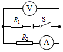

# Physics - 题目 1479

**ID**: a663445722784f8a94a339d5889ca529
**年级**: Grade 9
**难度**: Medium-Hard
**题型**: Fill-in-the-blank

## 题目
在如图所示的电路中，R_{1}、R_{2}为定值电阻且阻值相等，电源电压为U且不变。​​​​​​​‌闭合开关S后，电路正常工作，电流表示数为I。一段时间后观察到仅有一个电表示数变小。已知电路中只有一处故障，且发生在电阻R_{1}或R_{2}上。请写出两电表的示数及其对应的故障。

## 解答

1. 由题意可知，电压表测的是R_{2}两端的电压；假设R_{1}短路，那么电压表测的是电源电压，电压表的示数变大，根据 $I=\frac {U}{R}$ 可知，电路中的总电阻变小，那么电流变大，即电流表的示数变大，两电表的示数都变大，这与题意不符合，故不可能是R_{1}短路；假设R_{1}断路，那么没有电流流过R_{1}、R_{2}和电流表，电流表示数为零，电压表的示数也为零，即两表的示数都变小，这与题意不符合，故不可能是R_{1}断路；假设R_{2}短路，那么电压表的示数变小，变为零，电路中的总电阻变小，根据 $I=\frac {U}{R}$ 可知，电流变大，这与题意相符合，由题意可知 $I=\frac {U}{2R}$ ，而R_{2}短路后
2. $I{^{^{′}}}=\frac {U}{R}=2I$
3. 即电流表的示数是2I；假设R_{2}断路，那么没有电流流过电流表，电流表示数变小为零，电压表测的是电源电压U，电压示数变大，这与题意相符合。

## 知识点

**中文**:
  - 应用欧姆定律进行电路故障分析
  - 电流表、电压表在判断电路故障中的应用

**English**:
  - Circuit Fault Analysis using Ohm's Law
  - Using Meters to Diagnose Circuit Faults

---
