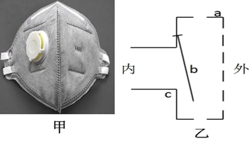

# Physics - 题目 290

**ID**: ba1eb77a75c14617908f491077e0fa98
**年级**: Grade 9
**难度**: Medium-Hard
**题型**: Fill-in-the-blank

## 题目
目前新型冠状病毒肺炎席卷全球，我国提倡全民佩戴口罩，以阻止疫情的传播。​​​​​​​‌如图甲是一种带呼吸阀的国产KN95口罩，呼吸阀是由带透气孔的塑料盒a和橡胶阀门b组成，其结构如图乙所示，自然状态下，阀门b与塑料盒的侧壁c密切贴合。呼气时，胸部收缩，肺的容积减小，肺内空气压强（增大/减小），气体排出体外进入口罩内，阀门b（打开/关闭），罩内废气排出；吸气时，阀门b（打开/关闭），阻止了空气中污染物的进入；根据以上分析，请你谈谈带有呼吸阀口罩的优缺点。（优缺点各写一条）

## 解答

1. [1]呼气时，胸部收缩，肺的容积减小，肺内气体质量不变，根据公式 $ρ=\frac {m}{V}$ 肺内气体密度增大，所以肺内气体压强增大。
2. [2]因为肺内气体压强大于外界大气压，所以气体排出体外进入口罩内，阀门在气体压强的作用下会打开。
3. [3]吸气时，胸部舒张，肺的容积变大，肺内气体质量不变，根据公式 $ρ=\frac {m}{V}$ 肺内气体密度减小，所以肺内气压变小，在大气压强的作用下，阀门关闭。
4. [4]优点：阻止了空气中污染物的进入；缺点：可能导致呼吸不畅。

## 知识点

**中文**:
  - 大气压的应用
  - 密度公式的应用

**English**:
  - Applications of Atmospheric Pressure
  - Application of Density Formula

---
