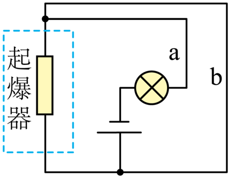

# Physics - 题目 2554

**ID**: c0267a6da70e4d03958533043da0f52c
**年级**: Grade 9
**难度**: Medium-Hard
**题型**: Fill-in-the-blank

## 题目
如图所示为某定时炸弹的引爆电路工作原理图，当起爆器中有电流通过时就会引爆炸弹。​​​​​​​‌请你结合所学知识进行排爆分析。（1）定时器（时钟）安装在（选填“a”或“b”）导线上。在定时阶段，该导线是（选填“通”或“断”）路，所以在定时阶段起爆器不会爆炸引爆炸弹；（2）为使该定时爆炸装置停止工作，在定时阶段应立即剪断导线（选填“a”或“b”）。

## 解答

1. [1]装置在拆除前，起爆器被短路，所以不工作，起爆器上没有电流通过，因此定时器（钟表）应该安装在b导线上。
2. [2]在定时阶段，该导线是通路，此时起爆噐被短路，电流不能通过起爆器，所以在定时阶段起爆器不会爆炸引爆炸弹。
3. [3]定时器（时钟）接在b导线上，在定时阶段，电路是通路，所以相当于是闭合的开关；为使爆炸装置停止工作，应剪断线a，这样电路就会因没有电源而处于断路状态。

## 知识点

**中文**:
  - 通路、断路和短路

**English**:
  - Closed, Open, and Short Circuits

---
