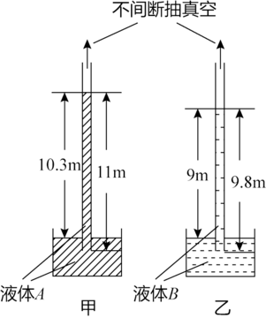
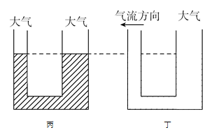

# Physics - 题目 1774

**ID**: cbfe4413430d4d1bace59b0d1f01eca4
**年级**: Grade 9
**难度**: Medium-Hard
**题型**: Fill-in-the-blank

## 题目
（1）在A地完成图甲所示的实验，则当地大气压等于m高的液柱A所产生的压强。​​​​​​​‌在B地完成图乙所示的实验，能否比较A、B两地的气压大小?如果能，请写出分析过程；如果不能，请写出原因：（液体A的密度比B大）；（2）如图丙，静止时U形管两侧液面相平。请在图丁中大致画出U形管两侧液面的高度。

## 解答

1. （1）[1]液体上表面上是空气，压强为大气压强，玻璃管上方是真空，所以应该测量玻璃管内液柱A的高度到水槽中水平面的竖直高度，通过该高度计算压强，所以当地大气压等于10.3m高的液柱A所产生的压强。
2. [2]液柱A到水平面的高度大于液柱B到水平面的高度，又因为液体A的密度大于液体B的密度，根据 $p=ρgh$ 可知，液柱A的压强大于液柱B的压强，即A地的大气压大于B地的大气压。
3. （2）[3]由图可知，左管上方的气体流动速度大，根据流速与压强的关系可知，左管上方的气体压强小，右管上方的气体流动速度小，压强大，这样左、右管的上方存在压强差，这样液体会在压强差的作用下向左流动，边的液柱会较高，作图如下：
4. 

## 知识点

**中文**:
  - 流体压强与流速的关系
  - 液体压强计算公式的应用

**English**:
  - Relationship between Fluid Pressure and Flow Speed
  - Application of Liquid Pressure Formula

---
