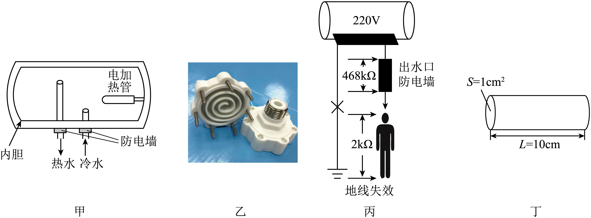

# Physics - 题目 2958

**ID**: d9cfe247e1254659bb9de7ae6886f386
**年级**: Grade 9
**难度**: Medium-Hard
**题型**: Fill-in-the-blank

## 题目
如图甲为储水式电热水器的内部结构，它利用加热管对水箱中的水进行加热.长时间使用后可能导致绝缘部分可能破损，使热水器中的外壳和水带电，从而造成触电事故.所以国家规定电热水器须采用接地、漏电保护器、防电墙等多重保护措施。​​​​​​​‌（本题不计热量损失）（1）若电热水器水箱容量为50L，额定功率1500W，则正常工作时，将水从20℃加热至50℃，计算说明至少需要多长时间？[c_{水}=4.2×10^{3}J/（kg•℃），ρ_{水}=1.0×10^{3}kg/m^{3}]（2）考虑到用电安全，电热水器应使用（选填“两孔”或“三孔”）插座，且进、出水管口都装有防电墙，其内部结构如图乙所示，流经其中的水必须沿着内部隔片螺旋流动，与普通水管相比其中的水柱变得更细更长，从而使水的电阻；（填变化情况）（3）若人体电阻为2kΩ，某种防电墙电阻为468kΩ，当如图丙所示地线失效时：①试用计算说明此防电墙能否保证人的安全？②若防电墙内部容积为10cm^{3}，横截面1cm^{2}，长度为10cm的自来水水柱的电阻为13kΩ，如图丁所示，已知水柱的电阻跟它的长度L成正比，跟它的横截面积S成反比，则此防电墙中需要将内部的水分隔成长度为cm的螺旋水柱。（不考虑内部隔片本身的厚度影响，只填结果）

## 解答

1. （1）水的质量
2. m=ρ_{水}V=1×10^{3}kg/m^{3}×50×10^{-3}m^{3}=50kg
3. 水吸收的热量
4. Q=c_{水}mΔt=4.2×10^{3}J/（kg·℃）×50kg×（50℃-20℃）=6.3×10^{6}J
5. 需要加热的时间
6. $t=\frac {W}{P}=\frac {Q}{P}=\frac {6.3\times 10{^{6}}{\rm{J}}}{1500{\rm{W}}}=4200{\rm{s}}$
7. （2）电热水器有金属外壳，为了用电的安全，其外壳必须要接地，故应使用三孔插座。
8. 导体的电阻与导体的材料、横截面积、长度和温度有关；流经防电墙中的水必须沿着内部隔片螺旋流动，与普通水管相比其中的水柱变得更细更长，使水的横截面积变小，长度变大，从而使水的电阻变大。
9. （3）防电墙与人体电阻串联，由串联分压可知
10. $\frac {U{{}_{1}}}{U{{}_{2}}}=\frac {R{{}_{1}}}{R{{}_{2}}}=\frac {468kΩ}{2kΩ}=\frac {234}{1}$
11. 由串联电路电压的规律可知
12. U_{1}+U_{2}=220V
13. 人体的电压
14. U_{2}≈0.9V<36V
15. 此防电墙能保证人的安全。
16. 水柱的电阻跟它的长度L成正比，跟它的横截面积S成反比，则水柱的电阻
17. $R=\frac {kL}{S}$
18. 横截面长度为10cm的自来水水柱的电阻为13kΩ，带入上式得到
19. $13KΩ=\frac {{\rm{k}}{{1}}{{0}}{\rm{c}}{\rm{m}}}{{{1}}{\rm{c}}{\rm{m}}{^{{{2}}}}}$
20. k=1.3kΩ/cm
21. 防电墙内部容积为10cm^{3}，防电墙电阻为468kΩ，则
22. $468{\rm{k}}{\rm{Ω}}=1.3{\rm{k}}{\rm{Ω}}/{\rm{c}}{\rm{m}}\times \frac {L^{′}}{\frac {10{\rm{c}}{\rm{m}}{^{{{3}}}}}{L^{′}}}$
23. 此防电墙中需要将内部的水分隔成的螺旋水柱长度
24. L^{'}=60cm

## 知识点

**中文**:
  - 电与热综合计算

**English**:
  - Comprehensive Calculation of Electricity and Heat

---
