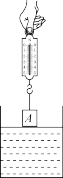

# Physics - 题目 1060

**ID**: e59a6914d46f4a6884bc226ec7a0bfda
**年级**: Grade 9
**难度**: Medium-Hard
**题型**: Fill-in-the-blank

## 题目
如图所示，底面积为100cm^{2}的圆柱体容器放在水平桌面的中央，容器中装有10cm深的水，此时水对容器底压强Pa。​​​​​​​‌将一个重4N，高为10cm底面积为25cm^{2}的实心长方体A挂在弹簧测力计上，物体A下表面刚碰到水面，然后竖直缓慢使物体A下移4.5cm，使物体A保持静止（水没有溢出），则此时弹簧测力计的读数为N。（g＝10N/kg）

## 解答

1. [1]容器中装有10cm深的水，即
2. h＝10cm＝0.1m
3. 则容器底部受到的水的压强
4. p＝ρgh＝1.0×10^{3}kg/m^{3}×10N/kg×0.1m＝1000Pa
5. [2]竖直缓慢使物体A下移4.5cm后，若水面不动，则排开水的体积
6. V_{排}＝S_{A}h_{下移}＝25cm^{2}×4.5cm＝112.5cm^{3}
7. 事实上，物体浸入后会排开周围的水，导致水面升高，所以，排开水的体积又可表示为
8. V_{排}＝（S_{容}﹣S_{A}）△h
9. 则水面升高的高度
10. △h＝ $\frac {V{{}_{排}}}{S{{}_{容}}-S{{}_{{\rm{A}}}}}$ ＝ $\frac {112.5{\rm{c}}{\rm{m}}{^{3}}}{100{\rm{c}}{\rm{m}}{^{2}}-25{\rm{c}}{\rm{m}}{^{2}}}$ ＝1.5cm
11. 因此，物体实际浸入深度为
12. h_{浸}′＝h_{下移}+△h＝4.5cm+1.5m＝6cm
13. 此时物体实际排开水的体积为
14. V_{排}′＝S_{A}h_{浸}′＝25cm^{2}×6cm＝150cm^{3}＝1.5×10^{﹣}^{4}m^{3}
15. 此时物体A受到的浮力
16. F_{浮}′＝ρ_{水}gV_{排}′＝1×10^{3}kg/m^{3}×10N/kg×1.5×10^{﹣}^{4}m^{3}＝1.5N
17. 则此时弹簧测力计的读数
18. F_{示}＝G﹣F_{浮}′＝4N﹣1.5N＝2.5N
19. 即此时弹簧测力计的读数为2.5N。

## 知识点

**中文**:
  - 浮力大小的计算
  - 液体压强的大小及其计算
  - 阿基米德原理的应用

**English**:
  - Calculation of Buoyancy
  - Magnitude and Calculation of Liquid Pressure
  - Applications of Archimedes' Principle

---
