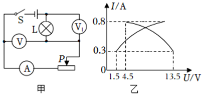

# Physics - 题目 148

**ID**: ef8e8ed98410464a8e7aec57954da043
**年级**: Grade 9
**难度**: Medium-Hard
**题型**: Fill-in-the-blank

## 题目
如图甲所示，闭合开关S，调节滑动变阻器的滑片P从最右端滑至小灯泡正常发光的位置，电流表示数与两电压表示数的关系如图乙所示。​​​​​​​‌则小灯泡的额定功率为W。

## 解答

1. U=UL1+U滑=1.5V+13.5V=15V
2. 根据题意可知，当电流表示数最大时，灯泡正常发光，由图乙可知，此时电路电流为0.8A，滑动变阻器两端电压为4.5V，因串联电路两端电压等于各部分电压之和，所以灯泡的额定电压为
3. UL=U-U滑1=15V-4.5V=10.5V
4. 灯泡的额定功率为
5. PL=ULI最大=10.5V×0.8A=8.4W

## 知识点

**中文**:
  - 电功率的计算及应用
  - 电路的动态分析

**English**:
  - Calculation and Application of Electric Power
  - Dynamic Circuit Analysis

---
