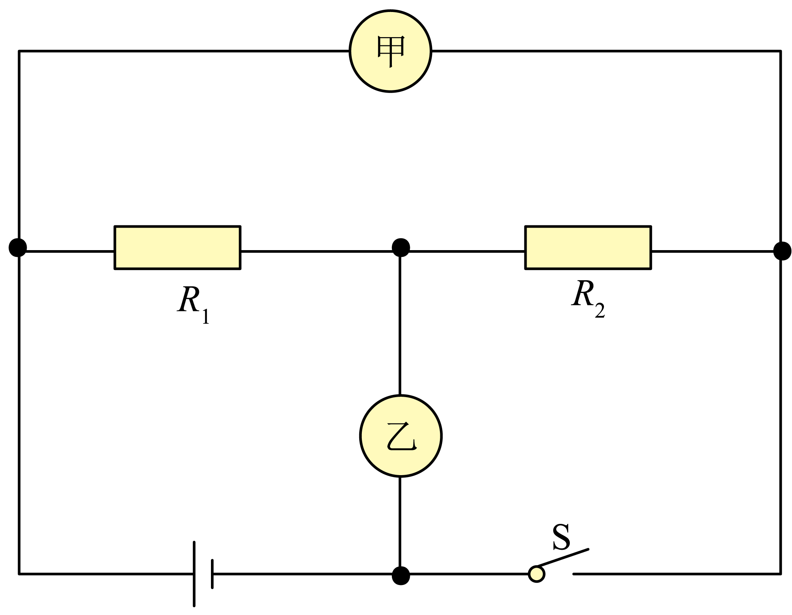

# Physics - 题目 522

**ID**: f44c44257df64e0eae6d93007318ea64
**年级**: Grade 9
**难度**: Medium-Hard
**题型**: Fill-in-the-blank

## 题目
如图所示，当开关S闭合，甲、乙两表为电压表时，两表读数之比U_{甲}:U_{乙}为4:1；​​​​​​​‌当开关S断开，甲、乙两表为电流表时，两表的读数之比I_{甲}:I_{乙}为

## 解答

1. 当开关S闭合，甲乙两表是电压表时，两电阻串联，甲电压表则电源电压，乙电压表测R_{2}的电压
2. $U{{}_{甲}}:U{{}_{乙}}=4:1$
3. 即
4. $U{{}_{甲}}=4U{{}_{乙}}$
5. 由串联电路电压的规律，R_{1}的电压为
6. $U{{}_{R1}}=U{{}_{甲}}-U{{}_{乙}}=4U{{}_{乙}}-U{{}_{乙}}=3U{{}_{乙}}$
7. 由分压原理知
8. $R{{}_{1}}:R{{}_{2}}=3U{{}_{乙}}:U{{}_{乙}}=3:1$
9. 当开关S断开，甲乙两表是电流表时，两电阻并联，甲电流表测R_{2}的电流，乙电流表测并联电路的总电流，根据并联电路各支路电压相等，由 $I=\frac {U}{R}$ 和电流与电阻成反比，故R_{1}和R_{2}的电流之比为
10. $I{{}_{1}}:I{{}_{2}}=R{{}_{2}}:R{{}_{1}}=1:3$
11. 则通过R_{1}的电流为 $ \frac {1}{3}I{{}_{2}}$ ，由并联电路电流的规律，干路电流为
12. $I{{}_{乙}}=I{{}_{2}}+\frac {1}{3}I{{}_{2}}=\frac {4}{3}I{{}_{2}}$
13. 两电流表的示数之比
14. $I{{}_{甲}}:I{{}_{乙}}=I{{}_{2}}:\frac {4}{3}I{{}_{2}}=3:4$

## 知识点

**中文**:
  - 串联电路的电流规律
  - 欧姆定律的应用

**English**:
  - Current Law in Series Circuits
  - Applications of Ohm's Law

---
