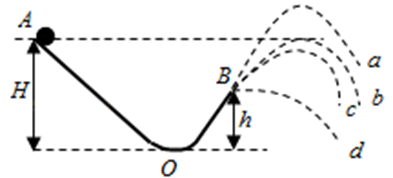

# Physics - 题目 2634

**ID**: f6d3bae7f5bd491ca4a286887aafa626
**年级**: Grade 9
**难度**: Medium-Hard
**题型**: Fill-in-the-blank

## 题目
如图AOB是光滑轨道，A点的高度H大于B点的高度h，让小钢球从A点由静止开始自由滑下，沿轨道AOB到达B点后离开（不计空气阻力）。​​​​​​​‌(1)小钢球从A点滑到O点的过程中动能，重力势能；（选填“变大”或“变小”）(2)查阅资料得知：物体的动能、重力势能的表达式分别为EK＝$\frac {1}{2}$mv2、EP＝mgh，m为物体的质量，v为物体的速度，h为物体距离水平面的高度，物体的机械能是它的动能和重力势能之和。上述轨道是光滑的，则小钢球沿斜面下滑的过程中机械能守恒（即在轨道任一个位置小钢球的机械能的值不变）。若已知A点高度为1m，B点高度为55cm，则小球到达B点的速度是m/s；（g＝10N/kg）(3)小钢球离开B点后的运动轨迹最符合实际的是。

## 解答

1. (1)[1]小球从A点滑到O点的过程中，质量不变，速度增大，动能增大。
2. [2]小球从A点滑到O点的过程中，质量不变，高度减小，重力势能变小。
3. (2)[3]利用A、B两点机械能相等，即
4. $mgH=mgh+\frac {1}{2}mv{^{2}}$
5. 将H=1m，h=55cm=0.55m，g=10N/kg带入上式可得v=3m/s。
6. (3)[4]小球在右侧最高点时仍有向前的速度，由于小球的机械能守恒，所以小球的高度低于A点的高度；小球离开B点后由于惯性会继续向斜上方运动，同时小球在空中受到重力的作用，所以运动轨迹c是正确的。

## 知识点

**中文**:
  - 动能的变化问题
  - 重力势能的变化问题
  - 机械能守恒

**English**:
  - Changes in Kinetic Energy
  - Changes in Gravitational Potential Energy
  - Conservation of Mechanical Energy

---
