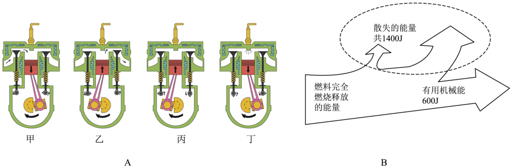

# Physics - 题目 1949

**ID**: fccbe95619584db3b9309d73d0041028
**年级**: Grade 9
**难度**: Medium-Hard
**题型**: Fill-in-the-blank

## 题目
发动机是汽车的核心部件，发动机的质量决定了整车的性能和品质，现代汽车主要分汽油与柴油两类发动机。​​​​​​​‌（1）如图A所示，汽油机一个工作循环包括四个冲程，一个汽缸正常工作四个冲程顺序是（按“甲、乙、丙、丁”重新排序），图所示冲程汽油机给汽车提供动力，将燃料燃烧放出的能转化为机械能。汽车发动机通常用水做冷却剂是因为水的；（2）如图B所示是某小轿车汽油机工作时的能量转化示意图，则该汽油机的效率是，该车完全燃烧2L汽油，释放的热量是J，若在效率不变的情况下，转化为有用的机械能是J。（汽油的密度ρ＝0.7×10^{3}kg/m^{3}，汽油的热值q＝4.6×10^{7}J/kg）；（3）近年来，我国汽车保有量在迅速增长。若一辆汽车每年耗油1.8t，汽车发动机的平均效率为25%，如果能把发动机效率提高1%，则每辆汽车每年大约可节约kg汽油（结果保留整数）。

## 解答

1. （1）[1]甲中的一个气阀打开，活塞向下运动，所以为吸气冲程，是第一冲程；乙中的一个气阀打开，活塞向上运动，所以为排气冲程，是第四冲程；丙中的两个气阀都关闭，活塞向上运动，所以为压缩冲程，是第二冲程；丁中的两个气阀都关闭，活塞下运动，所以为做功冲程，是第三冲程。故一个汽缸正常工作四个冲程顺序是排序为：甲丙丁乙。
2. [2][3]做功冲程燃料燃烧，把化学能转化为内能，高温高压的燃气对活塞做功，把内能转化为机械能，给汽车提供动力。
3. [4]汽车发动机工作时产生大量热量，这些热量如果不迅速转移，就可能损害发动机，由于水的比热容较大，质量和初温相同的水和其它液体相比较，升高相同的温度时，水吸收的热量多，因此汽车发动机通常用水做冷却剂。
4. （2）[5]该汽油机的效率
5. ${\rm η=\frac {W{{}_{有用}}}{Q}\times 100\%=\frac {600{\rm{J}}}{600{\rm{J}}{\rm{+}}1400{\rm{J}}}\times 100\%=30\%}$
6. 2L汽油的质量
7. m_{汽油}=ρ_{汽油}V=0.7×10^{3}kg/m^{3}×2×10^{-3}m^{3}=1.4kg
8. [6]该车完全燃烧2L汽油，释放的热量
9. Q=m_{汽油}q=1.4kg×4.6×10^{7}J/kg=6.44×10^{7}J
10. [7]若在效率不变的情况下，转化为有用的机械能
11. W_{有}=ηW_{总}=30%×6.44×10^{7}J=1.932×10^{7}J
12. （3）[8]内燃机效率提高1%，此时内燃机的效率
13. η_{2}=η_{1}+1%=25%+1%=26%
14. 由于
15. ${\rm η=\frac {W{{}_{有用}}}{Q}\times 100\%=\frac {W{{}_{有用}}}{mq}\times 100\%}$
16. 可知
17. ${\rm W{{}_{有用}}=ηqm}$
18. 因为内燃机效率提高后有用功是相同的，所以每辆汽车的有用功
19. η_{1}qm_{1}=η_{2}qm_{2}
20. 则
21. $m{{}_{2}}=\frac {η{{}_{1}}m{{}_{1}}}{η{{}_{2}}}$
22. 则每辆汽车每年节约燃油的质量
23. $Δm=m{{}_{1}}-m{{}_{2}}=m{{}_{1}}-\frac {η{{}_{1}}}{η{{}_{2}}}m{{}_{1}}=\left ({1-\frac {η{{}_{1}}}{η{{}_{2}}}}\right )m{{}_{1}}=\left ({1-\frac {25{\rm{\%}}}{26{\rm{\%}}}}\right )\times 1.8{\rm{t}}=0.069{\rm{t}}=69{\rm{k}}{\rm{g}}$

## 知识点

**中文**:
  - 有关热机效率的计算
  - 水的比热容的特点及应用
  - 热值及相关计算
  - 汽油机的构造与工作过程
  - 能量的转化

**English**:
  - Calculations of Heat Engine Efficiency
  - Characteristics and Applications of Water's Specific Heat
  - Calorific Value and Calculations
  - Structure and Operation of Gasoline Engines
  - Transformation of Energy

---
