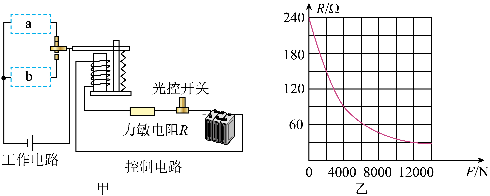

# Physics - 题目 329

**ID**: 0459c87ef59141719c0ecd9a5df5d832
**年级**: Grade 9
**难度**: Medium-Hard
**题型**: Multiple-choice

## 题目
如图甲是物理创新小组设计的“闯红灯违规模拟记录器”，控制电路电源电压为6V，电磁继电器线圈电阻为10Ω，R为力敏电阻，其阻值大小随压力F的变化关系如图乙所示。​​​​​​​‌当光控开关接收到绿光时断开，工作电路中指示灯亮，电控照相机不工作，当光控开关接收到红光时自动闭合，且当力敏电阻受到车的压力增大到一定数值，控制电路中电流等于或大于0.06A时，电控照相机开始拍照，g取10N/kg。下列说法中不正确的是（      ）

## 解答

1. A．可以适当增加线圈的匝数，磁铁的吸引力变强，控制电路的更小的电流就能够把衔铁吸引下来，则总电阻可以更大些，力敏电阻也可以更大一些，压力可以更小一些，即使质量较小的车闯红灯也能被拍下，故A错误，符合题意；
2. B．当控制电路中电流等于0.06A时，总电阻为 $R{{}_{总}}=\frac {U}{I}{\rm{=}}\frac {6{\rm{V}}}{0{{.}}06{\rm{A}}}{\rm{=}}100Ω$ ，力敏电阻的阻值为 $R{{}_{压}}=R{{}_{总}}{{-}}R{{}_{线}}{\rm{=}}100Ω{{-}}10Ω{\rm{=}}90Ω$ ，闯红灯的车对力敏压阻的压力为4000N，故B正确，不符合题意；
3. C．当质量为1200kg的车闯红灯时，力敏电阻所受的压力为 $F=mg{\rm{=}}{{1}}{{2}}{{0}}{{0}}{\rm{k}}{\rm{g}}\times {{1}}{{0}}{\rm{N}}{\rm{/}}{\rm{k}}{\rm{g}}{\rm{=}}{{1}}{{2}}{{0}}{{0}}{{0}}{\rm{N}}$ ，此时力敏电阻为30Ω，总电阻为 $R{{}_{总}}=R{{}_{压}}+R{{}_{线}}{\rm{=}}30Ω{{+}}10Ω{\rm{=}}40Ω$ ，控制电路的电流为 $I=\frac {U}{R{{}_{总}}}{\rm{=}}\frac {6{\rm{V}}}{40Ω}{\rm{=}}0{{.}}15{\rm{A}}$ ，控制电路消耗的总功率为 $P=UI=6{\rm{V}}\times 0{{.}}15{\rm{A}}{\rm{=}}{{0}}{{.}}{{9}}{\rm{W}}$ ，故C正确，不符合题意；
4. D．当力敏电阻受到车的压力增大到一定数值，控制电路中电流等于或大于0.06A时，衔铁吸下来，b处接通，电控照相机开始拍照，b处是电控照相机，则a处是指示灯。故D正确，不符合题意。

## 知识点

**中文**:
  - 影响电磁铁磁性强弱的因素
  - 欧姆定律的应用
  - 电路的动态分析
  - 电功率的计算及应用
  - 电磁继电器的常见应用

**English**:
  - Factors Affecting Electromagnet Strength
  - Applications of Ohm's Law
  - Dynamic Circuit Analysis
  - Calculation and Application of Electric Power
  - Common Applications of Electromagnetic Relays

---
