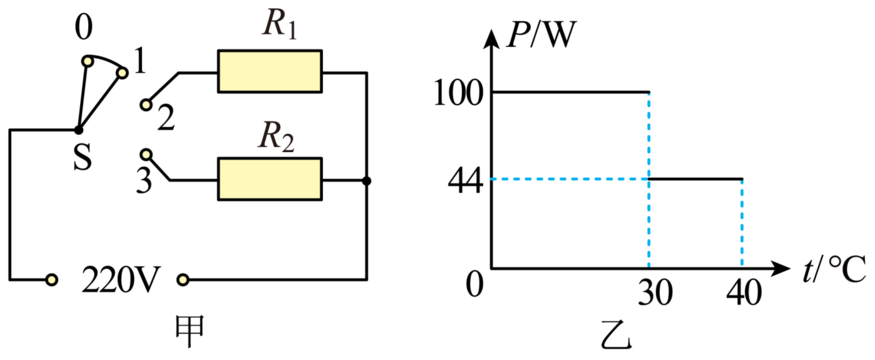

# Physics - 题目 1162

**ID**: 10e1ad7527ad4f0db0e0af92d5f5f645
**年级**: Grade 9
**难度**: Medium-Hard
**题型**: Multiple-choice

## 题目
某品牌智能电热毯能够根据环境温度自动实现多挡位加热，以增强人体舒适度。​​​​​​​‌其等效电路简化图如图甲所示，R_{1}、R_{2}均为加热电阻，R_{1}>R_{2}，S为智能开关，可根据实际选择不同电阻接入电路。某段工作过程，加热功率随环境温度变化如图乙所示。下列说法中正确的是（      ）

## 解答

1. A．环境温度为25℃时，观察图乙，可知，这时加热功率为100W，功率较大，根据电功率公式 $P=\frac {U{^{2}}}{R}$ 可知，电路的总电阻较小，观察图甲，智能开关S连接接线柱1和2时，只有电阻R_{1}接入电路，智能开关S连接接线柱2和3时，R_{1}和R_{2}并联接入电路，电路的总电阻比智能开关S连接接线柱1和2时的，还要小，则环境温度为25℃时，应该是智能开关S连接接线柱2和3，故A错误；
2. B．环境温度为35℃时，观察图乙，可知，这时加热功率为44W，功率较小，根据电功率公式 $P=\frac {U{^{2}}}{R}$ 可知，电路的总电阻较大，由A解析可知，只有仅仅电阻R_{1}接入电路时，电路的总电阻才较大，则智能开关S是连接接线柱1和2，故B错误；
3. C．开关S连接接线柱1和2，只有电阻R_{1}接入电路，电路的总电阻较大，加热功率较小，为44W=0.044kW，则工作1h产生的热量为 $Q=W=Pt={{0}}{{.}}{{0}}{{4}}{{4}}{\rm{k}}{\rm{W}}\times {{1}}{\rm{h}}={{0}}{{.}}{{0}}{{4}}{{4}}{\rm{k}}{\rm{W}}\cdot {\rm{h}}$
4. 工作1h产生的热量为 ${{0}}{{.}}{{0}}{{4}}{{4}}{\rm{k}}{\rm{W}}\cdot {\rm{h}}$ ，故C错误；
5. D．开关S连接接线柱2和3时，加热功率较大，为100W，电源电压为220V，根据电功率公式 $P=\frac {U{^{2}}}{R}$ 可知，电路的总电阻为 $R{{}_{总}}=\frac {U{^{2}}}{P{^{^{′}}}}=\frac {{\left({{{2}}{{2}}{{0}}{\rm{V}}}\right)^{2}}}{{{1}}{{0}}{{0}}{\rm{W}}}={{4}}{{8}}{{4}}{\rm{Ω}}$
6. 电路总电阻为484Ω，故D正确。

## 知识点

**中文**:
  - 电功率的计算及应用

**English**:
  - Calculation and Application of Electric Power

---
