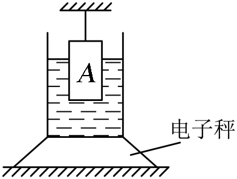

# Physics - 题目 1242

**ID**: 1560b5d236c14708b0f6fa9614385e86
**年级**: Grade 9
**难度**: Medium-Hard
**题型**: Multiple-choice

## 题目
如图所示，电子秤上放置一个装有适量水的圆柱形容器（容器足够高，厚度与质量均忽略不计），已知水的质量为800g，容器的底面积为100cm^{2}。​​​​​​​‌将一个质量为600g、体积为1000cm^{3}的实心圆柱体A用细线系着，将其一半浸入水中（不考虑物体A吸水）。下列说法错误的是（      ）

## 解答

1. A．A所受的浮力为 $F{{}_{浮}}=ρ{{}_{水}}gV{{}_{排}}=1.0\times 10{^{3}}{\rm{k}}{\rm{g}}/{\rm{m}}{^{3}}\times 10{\rm{N}}/{\rm{k}}{\rm{g}}\times \frac {1}{2}\times 1000\times 10{^{-6}}{\rm{m}}{^{3}}=5{\rm{N}}$ ，
2. 故A正确，不符合题意；
3. B．水的重力 $G{{}_{水}}=m{{}_{水}}g=800\times 10{^{-3}}{\rm{k}}{\rm{g}}\times 10{\rm{N}}/{\rm{k}}{\rm{g}}=8{\rm{N}}$ ，图中绳子对物体的拉力为， $F=G{{}_{A}}-F{{}_{浮}}$ ，容器对电子秤的压力为 $F{{}_{压}}=G{{}_{水}}+G{{}_{A}}-F=G{{}_{水}}+F{{}_{浮}}=8{\rm{N}}+5{\rm{N}}=13{\rm{N}}$ ，故B错误，符合题意；
4. C．物体 $A$ 的重力 $G{{}_{A}}=m{{}_{A}}g=600\times 10{^{-3}}{\rm{k}}{\rm{g}}\times 10{\rm{N}}/{\rm{k}}{\rm{g}}=6{\rm{N}}>F{{}_{浮}}$ ，且实心长方体A的密度 $ρ=\frac {m}{V}=\frac {600{\rm{g}}}{1000{\rm{c}}{\rm{m}}{^{3}}}=0.6{\rm{g}}/{\rm{c}}{\rm{m}}{^{3}}<1.0{\rm{g}}/{\rm{c}}{\rm{m}}{^{3}}$ ，则剪断细线后，实心长方体A静止时处于漂浮状态 $（$ 此时 $F{{}_{浮}}{\rm{^{′}}}=G{{}_{A}}=6{\rm{N}}）$ ，所以剪断细线后，长方体排开水的体积变大，受到的浮力变大，当浮力和重力相等时， $A$ 最终处于漂浮状态，所以， $A$ 物体下表面所处的深度先增大，最终静止不变，由 $p=ρgh$ 可知， $A$ 物体下表面受到的压强先变大，最终不变，故C正确，不符合题意；
5. D．因烧杯为柱形容器，所以若剪断细线，待液面静止后 $（$ 物体漂浮 $）$ ，水对容器底的压力等于水和 $A$ 物体的重力之和，即水对容器底的压力 $F=G{{}_{水}}+G{{}_{A}}=8{\rm{N}}+6{\rm{N}}=14{\rm{N}}$ ，则水对容器底的压强为 $p=\frac {F}{S}=\frac {14{\rm{N}}}{100\times 10{^{-4}}{\rm{m}}{^{2}}}=1400{\rm{P}}{\rm{a}}$ ，故D正确，不符合题意。

## 知识点

**中文**:
  - 密度、压强和浮力的综合

**English**:
  - Integrated Density, Pressure, and Buoyancy

---
