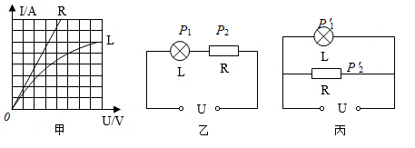

# Physics - 题目 1371

**ID**: 19e1b0f9dc3f4c729cb694ba5d6de646
**年级**: Grade 9
**难度**: Medium-Hard
**题型**: Multiple-choice

## 题目
如图甲是灯泡L和电阻R的I-U关系图像，灯丝电阻受温度的影响，温度越高电阻越大。​​​​​​​‌将L和R以两种不同的方式接在同一电源上，如图乙和丙，若乙图中灯泡、电阻的电功率 $P{{}_{1}}:P{{}_{2}}=m$ ，丙图中灯泡、电阻的电功率 $P{{}_{1}}{^{\prime }}:P{{}_{2}}{^{\prime }}=n$ ，则下列关系式中正确的是（      ）

## 解答

1. 在图乙中，灯泡与电阻串联，电路中通过电流相等，由题知 $P{{}_{1}}:P{{}_{2}}=m$ ，根据P=UI可知，通过电流相等时，电功率之比等于两端电压之比，则有
2. $\frac {P{{}_{1}}}{P{{}_{2}}}=\frac {U{{}_{1}}}{U{{}_{2}}}=m$
3. 由 $I=\frac {U}{R}$ 可知，电流相同时，电压与电阻成正比，则有
4. $\frac {P{{}_{1}}}{P{{}_{2}}}=\frac {U{{}_{1}}}{U{{}_{2}}}=\frac {R{{}_{L乙}}}{R}=m$
5. 在图丙中，灯泡与电阻并联，各支路两端两端电压相等，由题知 $P{{}_{1}}{^{\prime }}:P{{}_{2}}{^{\prime }}=n$ ，根据P=UI可知，电压相同时，电功率之比等于电流之比，有
6. $\frac {P{{}_{1}}{^{\prime }}}{P{{}_{2}}{^{\prime }}}=\frac {I{{}_{1}}{^{\prime }}}{I{{}_{2}}{^{\prime }}}=n$
7. 由 $I=\frac {U}{R}$ 可知，电压相同时，电流与电阻成反比，则有
8. $\frac {P{{}_{1}}{^{\prime }}}{P{{}_{2}}{^{\prime }}}=\frac {I{{}_{1}}{^{\prime }}}{I{{}_{2}}{^{\prime }}}=\frac {R}{R{{}_{L丙}}}=n$
9. 即
10. $\frac {R{{}_{L丙}}}{R}=\frac {1}{n}$
11. 灯丝电阻受温度的影响，温度越高电阻越大，由图甲可知， $R{{}_{L乙}}$ 小于 $R{{}_{L丙}}$ ，所以
12. $\frac {R{{}_{L乙}}}{R}<\frac {R{{}_{L丙}}}{R}$
13. 即
14. $m<\frac {1}{n}$
15. 综上所述：ABD项错误，C项正确。
16. 故选C。

## 知识点

**中文**:
  - 串、并联电路中的电功率

**English**:
  - Electric Power in Series/Parallel Circuits

---
