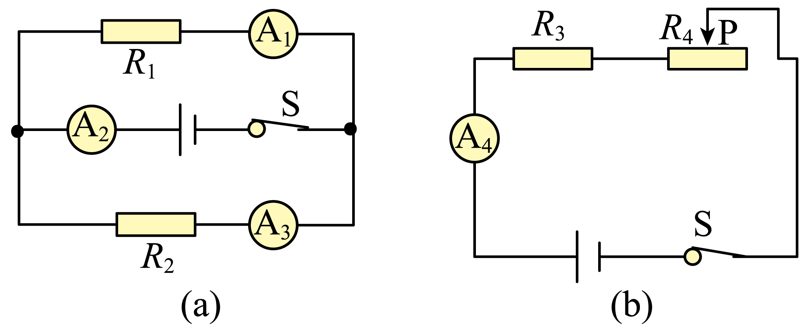

# Physics - 题目 2883

**ID**: 1a0af94b5ff64ac4a8d036042dec680d
**年级**: Grade 9
**难度**: Medium-Hard
**题型**: Multiple-choice

## 题目
在如图（a）、（b）所示的电路中，所有元件均完好，电源电压相等且保持不变。​​​​​​​‌已知R_{1}、R_{2}、R_{3}为定值电阻，R_{4}为滑动变阻器（滑片在中点附近某位置），现有两个电流表的示数相同，则下列判断正确的是（      ）①A_{1}与A_{2}示数相同，R_{1}＜R_{2}②A_{1}与A_{3}示数相同，R_{1}＝R_{2}③A_{2}与A_{4}示数相同，R_{2}＞R_{3 }_{　　　　　　　}④A_{3}与A_{4}示数相同，R_{2}＝R_{3}

## 解答

1. ① ②从图(a)可以看到，这是一个并联电路，A_{2}测的是干路电流，A_{1}测的是R_{1}的电流，根据并联电路电流规律可知，A_{1}与A_{2}示数不可能相同，① 错误；假设A_{1}与A_{3}示数相同，根据欧姆定律的变换式 $R=\frac {U}{I}$ 可知，R_{1}和R_{2}两端电压相等，那么R_{1}＝R_{2}，② 正确；
2. ③由于电源电压相等，假设A_{2}与A_{4}示数相同，根据欧姆定律的变换式 $R=\frac {U}{I}$ 可知，图(a)中的总电阻是等于图(b)中的总电阻，即 $R=R{^{^{′}}}$ ，而图(a)中的总电阻
3. $R=\frac {R{{}_{1}}R{{}_{2}}}{R{{}_{1}}+R{{}_{2}}}$
4. 图(b)中的总电阻
5. $R{^{^{′}}}=R{{}_{3}}+R{{}_{4}}$
6. 即
7. $\frac {R{{}_{1}}R{{}_{2}}}{R{{}_{1}}+R{{}_{2}}}=R{{}_{3}}+R{{}_{4}}$
8. 化简可得
9. $R{{}_{3}}=\frac {R{{}_{1}}R{{}_{2}}}{R{{}_{1}}+R{{}_{2}}}-R{{}_{4}}$
10. 那么
11. $R{{}_{2}}-R{{}_{3}}=R{{}_{2}}-\left ({\frac {R{{}_{1}}R{{}_{2}}}{R{{}_{1}}+R{{}_{2}}}-R{{}_{4}}}\right )=R{{}_{2}}-\frac {R{{}_{1}}R{{}_{2}}}{R{{}_{1}}+R{{}_{2}}}+R{{}_{4}}=R{{}_{2}}\cdot \frac {R{{}_{2}}}{R{{}_{1}}+R{{}_{2}}}+R{{}_{4}}>0$
12. 可知 $R{{}_{2}}>R{{}_{3}}$ ，③ 正确；
13. ④ 由题意可知，图(a)中R_{2}两端的电压是等于图(b)中的电源电压，并且A_{3}与A_{4}示数相同，根据欧姆定律的变换式 $R=\frac {U}{I}$ 可知
14. $R{{}_{{\rm{2}}}}=R{{}_{{\rm{3}}}}+R{{}_{{\rm{4}}}}$
15. 那么 $R{{}_{{\rm{2}}}}\ne R{{}_{{\rm{3}}}}$ ，④ 错误；
16. 故选B。

## 知识点

**中文**:
  - 欧姆定律的变形公式
  - 欧姆定律的应用

**English**:
  - Transformed Formulas of Ohm's Law
  - Applications of Ohm's Law

---
