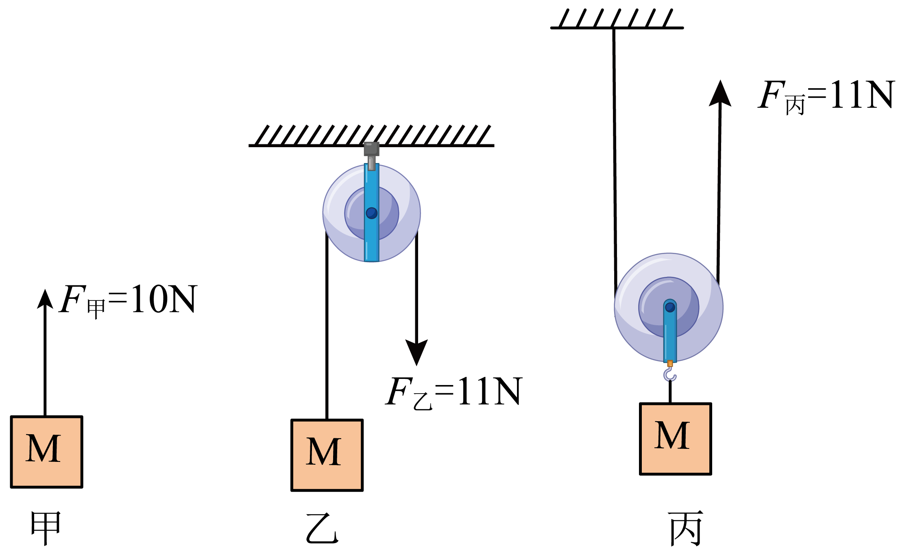

# Physics - 题目 470

**ID**: 1e4661e5ce944d9ca86be115fac2af69
**年级**: Grade 9
**难度**: Medium-Hard
**题型**: Multiple-choice

## 题目
如图分别使用甲、乙、丙三种方式把同一物体M匀速竖直提升，绳长不变，测得各拉力F大小如图，已知拉力F的作用点移动距离相等，则以下说法正确的是（      ）​​​​​​​‌

## 解答

1. A．由图示和题意可知，F乙和F丙两个力的大小相同，且拉力F的作用点移动距离s相等，根据W=Fs可知，F乙和F丙两个力所做的功（总功）相同，故A错误；
2. B．图乙中滑轮为定滑轮，图丙中滑轮为动滑轮，由两滑轮的特点可知，物体上升的高度
3. h乙=s
4. $h{{}_{丙}}＝\frac {1}{2}s$
5. 所以
6. h乙>h丙
7. 又因为机械乙和机械丙提升相同的物体，根据W=Gh可知，机械乙的有用功比机械丙的有用功大，故B正确；
8. C．甲图中直接匀速提升重物，则物重
9. GM=F甲=10N
10. 图丙中滑轮为动滑轮，若不计绳重和摩擦，根据 $F=\frac {1}{2}\left ({G{{}_{M}}+G{{}_{滑轮}}}\right )$ ，则滑轮的重力
11. G滑轮=2F丙-GM=2×11N-10N=12N
12. 但实际上绳重和摩擦是存在的，则滑轮重力不为12N，故C错误；
13. D．由前面解答可知，分别用机械乙和机械丙提升相同物体时，拉力做的总功相同，而机械乙的有用功比机械丙的有用功大，根据 $η{\rm{=}}\frac {W{{}_{有用}}}{W{{}_{总}}}\times 100{\rm{\%}}$ 可知，机械乙的机械效率较大，故D错误。
14. 故选B。

## 知识点

**中文**:
  - 动滑轮及其工作特点
  - 定滑轮及其工作特点
  - 滑轮（组）的机械效率及其计算

**English**:
  - Movable Pulleys and Operating Characteristics
  - Fixed Pulleys and Operating Characteristics
  - Mechanical Efficiency of Pulleys and Calculations

---
