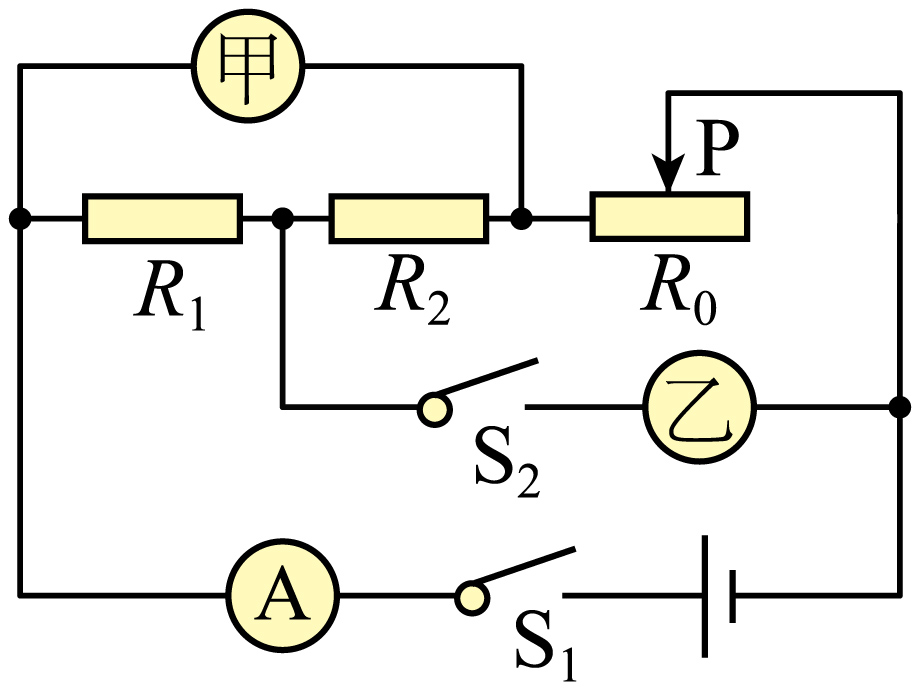

# Physics - 题目 2728

**ID**: 233186b2e7724c31aa1555b7d0cbd6b5
**年级**: Grade 9
**难度**: Medium-Hard
**题型**: Multiple-choice

## 题目
如图所示的电路中，电源电压不变。​​​​​​​‌只闭合开关S_{1}，滑片P移动到最左端，电路安全，电流表示数为I_{1}；再闭合开关S_{2}，电流表示数为I_{2}，且 $I{{}_{2}}>I{{}_{1}}$ 。下列说法正确的是（      ）

## 解答

1. A．只闭合S_{1}，滑片P移动到左端，电流表示数为I_{1}；若甲为电流表，则此时电源会被短路，故甲为电压表；由于电压表接入电路中时相当于是断路，若乙为电压表，闭合开关S_{2}，整个电路的总电阻不变，电流表示数不变，不符合题意，所以乙是电流表，故A错误；
2. B．只闭合S_{1}，该电路为串联电路，电压表甲测量的是R_{1}、R_{2}两端的电压，滑片P向右移动时，滑动变阻器接入电路的电阻变大，总电阻变大，根据欧姆定律可知，电路中的电流变小，根据U=IR可知，R_{1}、R_{2}两端的电压变小，即电表甲的示数变小，故B错误；
3. C．闭合S_{1}、S_{2}，电路为R_{1}的简单电路，R_{2}、滑动变阻器被短路，移动滑片，电路中的电流不变，乙表示数不变，故C错误；
4. D．将滑片移到右端，先闭合S_{1}，三个电阻串联接入电路中；再闭合S_{2}，R_{0}、R_{2}被短路，根据串联电路的电阻关系可知，此时电路的总电阻变小，根据公式 $P=\frac {U{^{2}}}{R}$ 可知，电路消耗的功率会变大，即P_{1}<P_{2}，故D正确。

## 知识点

**中文**:
  - 电功率的计算及应用
  - 电路的动态分析

**English**:
  - Calculation and Application of Electric Power
  - Dynamic Circuit Analysis

---
