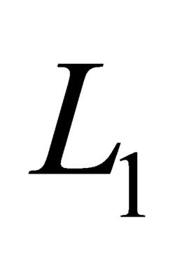
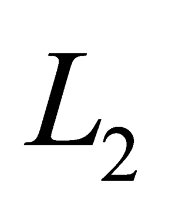
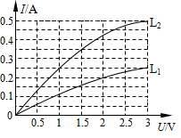

# Physics - 题目 2147

**ID**: 2465c509386344318c37e344ae05376e
**年级**: Grade 9
**难度**: Medium-Hard
**题型**: 单项选择题（共14个小题，每小题只有一个合理的选项，每小题3分，共42分）

## 题目
灯、分别标有“，”和“，”字样，通过、的电流随其两端电压变化的图象如图所示。​​​​​​​‌小丽进行了如下两次实验，首先将灯与滑动变阻器串联接在电源两端，调节滑片，使滑动变阻器的功率是功率的2倍；然后再将灯与滑动变阻器串联接在电源两端，调节滑片，使滑动变阻器的功率是功率的3倍，则下列说法正确的

## 解答

1. 解：、灯、分别标有“，”和“，”字样，两灯的额定电压相同，要使干路的电流最大，并联电路两端的电压等于灯泡的额定电压：，
2. 由的变形公式，可知的额定电流：，
3. 的额定电流：，
4. 根据并联电路的电流规律可得干路最大的电流：，故错误；
5. 、因为串联电路的电流处处相等，所以两灯串联时的最大电流为两个灯泡额定电流中较小的电流，，
6. 此时灯泡正常工作，其实际电功率等于额定功率：，
7. 时，由图可知灯泡两端的电压：，
8. 根据灯泡的实际功率：，
9. 根据并联电路的电功率规律可得，电路消耗的总功率：，故错误；
10. 、若将灯与滑动变阻器串联接在电源两端，调节滑片，当滑动变阻器的功率是功率的2倍时，则的功率为总功率的，串联电路中电流处处相等，根据可知两端的电压为总电压，即为，从图中可知通过的电流为，则的功率为，；
11. 若将灯与滑动变阻器串联接在电源两端，调节滑片，当滑动变阻器的功率是功率的3倍时，则的功率为总功率的，串联电路中电流处处相等，根据可知两端的电压为总电压的，即为，从图中可知通过的电流为，的功率为，；
12. 则，故正确；
13. ，故错误。
14. 故选：C。

## 知识点

**中文**:
  - 串联电路的电流规律
  - 并联电路的电流规律
  - 并联电路的电压规律
  - 电功率的计算及应用

**English**:
  - Current Law in Series Circuits
  - Current Law in Parallel Circuits
  - Voltage Law in Parallel Circuits
  - Calculation and Application of Electric Power

---
