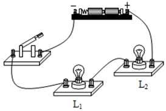

# Physics - 题目 1882

**ID**: 24c7eb503e084486b0ee9dab3c9922e0
**年级**: Grade 9
**难度**: Medium-Hard
**题型**: Multiple-choice

## 题目
小灯泡L_{1}标有“3V3W”，L_{2}标有“3V1.5W”字样，将它们连入电路如图所示。​​​​​​​‌忽略灯丝电阻变化，下列说法正确的是（      ）

## 解答

1. A．由P=UI可知，小灯泡L_{1}的额定电流为
2. $I{{}_{1}}=\frac {P{{}_{1}}}{U{{}_{1}}}=\frac {3{\rm{W}}}{3{\rm{V}}}=1{\rm{A}}$
3. 小灯泡L_{2}的额定电流为
4. $I{{}_{2}}=\frac {P{{}_{2}}}{U{{}_{2}}}=\frac {{\rm{1}}{\rm{.}}{\rm{5}}{\rm{W}}}{3{\rm{V}}}=0.5{\rm{A}}$
5. 又由 $P=\frac {U{^{2}}}{R}$ 可知，小灯泡L_{1}的电阻为
6. $R{{}_{1}}=\frac {U{{}_{1}^{2}}}{P{{}_{1}}}=\frac {{\left({3{\rm{V}}}\right)^{2}}}{3{\rm{W}}}=3{\rm{Ω}}$
7. 小灯泡L_{2}的电阻为
8. $R{{}_{2}}=\frac {U{{}_{2}^{2}}}{P{{}_{2}}}=\frac {{\left({3{\rm{V}}}\right)^{2}}}{{\rm{1}}{\rm{.}}{\rm{5}}{\rm{W}}}=6{\rm{Ω}}$
9. 因L_{1}与L_{2}串联，故电路中的最大电流为I=0.5A，故此时电源电压为
10. $U=I\left ({R{{}_{1}}+R{{}_{2}}}\right )=0.5{\rm{A}}\times \left ({3{\rm{Ω}}+6{\rm{Ω}}}\right )=4.5{\rm{V}}$
11. 因一节干电池的电压为1.5V，故最多可串联3节干电池，故A正确；
12. B．因L_{1}与L_{2}串联，故流过两灯的电流相等，由A中可知，L_{1}的电阻小于L_{2}的电阻，故由P=I^{2}R可知，开关闭合后，L_{2}的功率大于L_{1}的功率，即小灯泡L_{2}比L_{1}亮，故B错误；
13. C．由A中分析可知，当L_{2}正常发光时，此时电路中的电流为I=0.5A，故此时L_{1}的实际电功率为
14. $P{{}_{1}}=I{^{2}}R{{}_{1}}={\left({0.5{\rm{A}}}\right)^{2}}\times 3{\rm{Ω}}=0.75{\rm{W}}$
15. 故C错误；
16. D．若两灯并联在3V电压下，则此时两灯的实际功率等于额定功率，故小灯泡L_{1}与L_{2}消耗的实际功率之比为
17. 3W:1.5W=2:1
18. 故D错误。
19. 故选A。

## 知识点

**中文**:
  - 实际电压与实际功率
  - 欧姆定律的应用

**English**:
  - Actual Voltage and Actual Power
  - Applications of Ohm's Law

---
