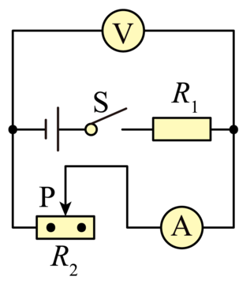

# Physics - 题目 1369

**ID**: 2ed3cb42a78a4ea291c164b8b9bd8c0c
**年级**: Grade 9
**难度**: Medium-Hard
**题型**: Multiple-choice

## 题目
如图所示，电源电压恒为6V，R_{1}＝10Ω，电流表量程为0～0.6A，电压表量程为0～3V，滑动变阻器R_{2}规格“20Ω 0.5A”。​​​​​​​‌闭合开关S后，在保证电路安全的前提下移动滑片P，下列描述正确的是（      ）

## 解答

1. AB．分析电路图可知，定值电阻R_{1}和滑动变阻器R_{2}串联在电路中，电压表测量R_{2}的两端电压，电流表量程为0～0.6A，电压表量程为0～3V，故当电压表为最大值3V时，电路中的电流最小为 $I{{}_{{\rm \min }}}=\frac {U-U{{}_{{{2}}}}}{R{{}_{{{1}}}}}=\frac {{{6}}{\rm{V}}{{-}}{{3}}{\rm{V}}}{{{1}}0{\rm{Ω}}}={{0}}{{.}}{{3}}{\rm{A}}$
2. 此时R_{2}为最大值 $R{{}_{{{2}}}}=\frac {U{{}_{{{2}}}}}{I{{}_{{\rm \min }}}}=\frac {{{3}}{\rm{V}}}{{{0}}{{.}}{{3}}{\rm{A}}}={{1}}0{\rm{Ω}}$
3. 当电流表为最大值0.6A时，R_{2}为最小值，此时 $R{{}_{总}}=\frac {U}{I{{}_{{\rm \max }}}}=\frac {{{6}}{\rm{V}}}{{{0}}{{.}}{{6}}{\rm{A}}}={{1}}0{\rm{Ω}}$
4. 则此时R_{2}为最小值0，故AB错误；
5. C．R_{1}电功率和电流表示数的关系为 $P{{}_{{{1}}}}=U{{}_{{{1}}}}I=I{^{2}}R{{}_{{{1}}}}$
6. 即R_{1}电功率与电流的平方成线性关系，故C错误；
7. D．电路总功率和电流表示数的关系为 $P=UI$
8. 当电路电流最小时，电路总功率最小，此时 $P{{}_{{\rm \min }}}=UI{{}_{{\rm \min }}}=6{\rm{V}}\times 0.3{\rm{A}}=1.8{\rm{W}}$
9. 当电路中电流为0.5A时，电路总功率为 $P=UI=6{\rm{V}}\times 0.5{\rm{A}}=3{\rm{W}}$
10. 故D正确。

## 知识点

**中文**:
  - 导体电阻是导体本身的一种性质
  - 欧姆定律的应用
  - 电路的动态分析
  - 电功率的计算及应用

**English**:
  - Resistance as an Intrinsic Property
  - Applications of Ohm's Law
  - Dynamic Circuit Analysis
  - Calculation and Application of Electric Power

---
