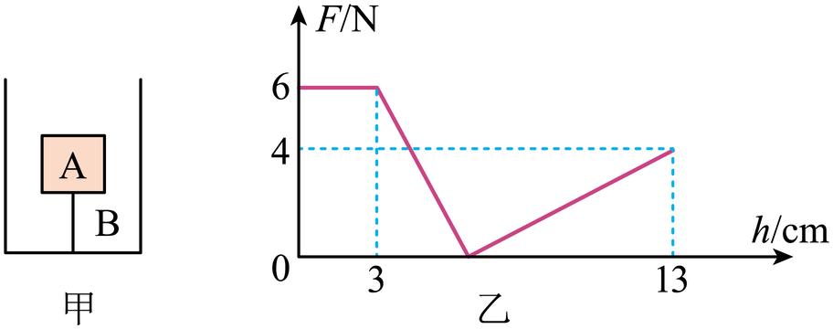

# Physics - 题目 2193

**ID**: 375c23089110418b98ac0578a6549d00
**年级**: Grade 9
**难度**: Medium-Hard
**题型**: Multiple-choice

## 题目
用传感器设计了如图甲所示的力学装置：竖直细杆B的下端通过力传感器固定在容器底部，它的上端与实心正方体A固定，不计细杆的质量和体积，力传感器可以显示出细杆B的下端受到作用力的大小。​​​​​​​‌现缓慢向容器中加水，当水深h为13cm时，正方体A刚好浸没，力传感器的示数大小F随水深变化的图像如图乙所示，则下列说法正确的是（      ）

## 解答

1. A．由图乙可知，当h_{0}=0cm时，力传感器的示数为F_{0}=6N，细杆的质量不考虑，细杆对力传感器的压力等于物体A的重力，即物体A的重力
2. G=F_{0}=6N
3. 由G=mg得，物体A的质量
4. $m=\frac {G}{g}=\frac {{{6}}{\rm{N}}}{{{1}}{{0}}{\rm{N}}{\rm{/}}{\rm{k}}{\rm{g}}}{\rm{=}}{{0}}{{.}}{{6}}{\rm{k}}{\rm{g}}$
5. 故A错误；
6. B．由图乙可知，当h_{1}=3cm时，水面恰好与物体A的下表面接触，当容器内水的深度h_{2}=13cm时，物体A刚好浸没，则物体A的边长为
7. L=13cm-3cm=10cm=0.1m
8. 物体A的体积为
9. V=L^{3}=（0.1m）^{3}=1×10^{−3}m^{3}
10. 物体A的密度为
11. $ρ=\frac {m}{V}=\frac {0.6{\rm{k}}{\rm{g}}}{1\times 10{^{-3}}{\rm{m}}{^{3}}}=0.6\times 10{^{-3}}{\rm{k}}{\rm{g}}{\rm{/}}{\rm{m}}{^{3}}=0.6{\rm{g}}{\rm{/}}{\rm{c}}{\rm{m}}{^{3}}$
12. 故B错误；
13. C．由图乙可知，水深高度为3cm以下时，传感器示数不变；3~13cm传感器的示数随水面的上升先变小后变大；13cm后传感器的示数不再变化，故C错误；
14. D．当容器内水的深度h_{3}=15cm时，物体A浸没在水中，此时物体A排开水的体积为物体的体积
15. V_{排}=V_{物}=1×10^{−3}m^{3}
16. 物体A受到的浮力为
17. F_{浮}=ρ_{水}gV_{排}=1×10^{3}kg/m^{3}×10N/kg×1×10^{−3}m^{3}=10N
18. 故D正确。

## 知识点

**中文**:
  - 重力公式的应用
  - 阿基米德原理的应用

**English**:
  - Application of Gravity Formula
  - Applications of Archimedes' Principle

---
