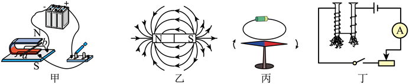

# Physics - 题目 1650

**ID**: 38cee89cd1a54f1bb00079933ae78dfa
**年级**: Grade 9
**难度**: Medium-Hard
**题型**: Multiple-choice

## 题目
如图所示，下列描述与实验相符的是（      ）​​​​​​​‌

## 解答

1. A．甲图有电源，闭合开关，导体棒在磁场中就会运动起来，说明通电导体在磁场中受到力的作用，是电动机原理，故A不符合题意；
2. B．条形磁体的周围的磁感线是从磁体的N极出发，回到磁体的S，而乙图中，磁感线是从S极回到N极，故B不符合题意；
3. C．将小磁针平行的放在导线下方，当导线中有电流通过时，小磁针就会发生偏转，说明通电导体周围存在磁场，即电流的磁效应，利用该原理制成了电磁铁，而动圈式话筒是根据电磁感应原理工作的，故C不符合题意；
4. D．丁图中，移动滑动变阻器的滑片，改变电路中的电流，观察左边（或右边）电磁铁吸引大头针数目改变的多少，就可以探究电磁铁的磁性强弱与电流大小的关系，故D符合题意。
5. 故选D。

## 知识点

**中文**:
  - 动圈式话筒的构造和原理
  - 磁感线及其特点
  - 影响电磁铁磁性强弱因素的探究实验
  - 直流电动机的原理

**English**:
  - Structure and Principle of Dynamic Microphone
  - Magnetic Field Lines and Characteristics
  - Experiment: Factors Affecting Electromagnet Strength
  - Principle of DC Motor

---
