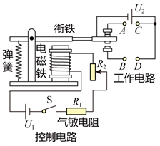

# Physics - 题目 98

**ID**: 39700a303d394a70851ae000391afcfb
**年级**: Grade 9
**难度**: Medium-Hard
**题型**: Multiple-choice

## 题目
如图所示是小敏设计的汽车尾气中CO排放量的检测电路。​​​​​​​‌当CO浓度高于某一设定值时，电铃发声报警。图中气敏电阻R_{1}阻值随CO浓度的增大而减小。下列说法正确的是（      ）

## 解答

1. AB．由题意可知，气敏电阻R_{1}阻值随CO浓度的增大而减小，当CO浓度高于某一设定值时，气敏电阻变小，电磁铁通过的电流变大，电磁铁磁性增强吸引衔铁向下运动，BD接入电路，则电铃应接在B和D之间，故AB错误；
2. C．用久后，电源电压U_{1}会减小，保证电磁铁电流一定的情况下，气敏电阻的阻值需要更低，则报警时CO最小浓度比设定值高，故C正确；
3. D．为使该检测电路在CO浓度更低时报警，应增大电路中的电流，可将R_{2}的滑片向上移使变阻器接入的电阻变小，故D错误。
4. 故选C。

## 知识点

**中文**:
  - 电磁继电器的常见应用
  - 电磁继电器的构造及原理

**English**:
  - Common Applications of Electromagnetic Relays
  - Structure and Principle of Electromagnetic Relays

---
