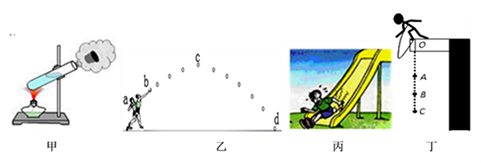

# Physics - 题目 2269

**ID**: 3d529c1666404a52acf6c62de5f9abe4
**年级**: Grade 9
**难度**: Medium-Hard
**题型**: Multiple-choice

## 题目
对于如图中所示的四幅图，下列说法中错误的是​​​​​​​‌

## 解答

1. A. 甲图中试管内的水蒸气推动塞子冲出时，水蒸气对塞子做功，水蒸气的内能减少，温度降低，故A正确；不符合题意；
2. B. 乙图中运动员投掷铅球时，铅球在最高点C点时，在水平方向上有一定的速度，此时动能不为0，故B正确；不符合题意；
3. C. 丙图中小朋友匀速下滑时，速度不变，动能不变，高度减小，重力势能减小，重力势能没有转化为动能，故C错误；符合题意；
4. D. 游戏者从跳台到a的过程中,高度减小、速度增大,重力势能减小,动能增大;从a点到c点的过程中(如下图)，ab段人的重力大于弹性绳的向上拉力，游戏者做加速运动，动能增大；bc段人的重力小于弹性绳的向上拉力，游戏者做减速运动，动能减小，最低点时动能为零；
5. 
6. 所以，整个过程中，游戏者的动能先增大后减小，故D正确．不符合题意．故选C.

## 知识点

**中文**:
  - 动能和势能的转化
  - 动能的变化问题
  - 重力势能的变化问题
  - 温度、热量与内能的关系

**English**:
  - Transformation between Kinetic and Potential Energy
  - Changes in Kinetic Energy
  - Changes in Gravitational Potential Energy
  - Relationship between Temperature, Heat, and Internal Energy

---
