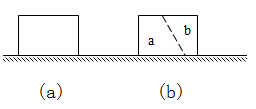

# Physics - 题目 835

**ID**: 419f89e87eba4ac394685de1a4d6c326
**年级**: Grade 9
**难度**: Medium-Hard
**题型**: Multiple-choice

## 题目
如图（a）所示，一个质量分布均匀的长方体静止在水平面上，它对水平面的压强为p。​​​​​​​‌若将它沿斜线切割为如图2（b）所示的两部分，它们对水平面的压强分别p_{a}和p_{b}，则（      ）

## 解答

1. 原来的正方体放在水平地面上，对地面的压强为
2. $p=\frac {G}{S}=\frac {ρVg}{S}=\frac {ρShg}{S}=ρgh$
3. 若沿如图所示的虚线方向切成a、b两部分，由图知对a两部分
4. V_{a}＜S_{a}h
5. a两部分对水平面的压强
6. $p{{}_{a}}=\frac {G{{}_{a}}}{S{{}_{a}}}=\frac {m{{}_{a}}g}{S{{}_{a}}}=\frac {ρV{{}_{a}}g}{S{{}_{a}}}<\frac {ρS{{}_{a}}hg}{S{{}_{a}}}=ρgh=p$
7. 即
8. p_{a}＜p
9. 对b两部分
10. V_{b}>S_{b}h
11. b两部分对水平面的压强
12. $p{{}_{b}}=\frac {G{{}_{b}}}{S{{}_{b}}}=\frac {m{{}_{b}}g}{S{{}_{b}}}=\frac {ρV{{}_{b}}g}{S{{}_{b}}}>\frac {ρS{{}_{b}}hg}{S{{}_{b}}}=ρgh=p$
13. 即
14. P_{b}>p
15. 综上
16. p_{a}＜p＜p_{b}
17. 故选D。

## 知识点

**中文**:
  - 压强大小的比较

**English**:
  - Comparing Pressure

---
