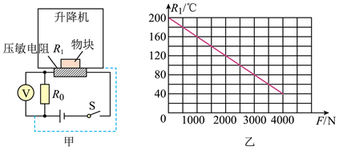

# Physics - 题目 967

**ID**: 4545f481c5014204b8064c436c1ec322
**年级**: Grade 9
**难度**: Medium-Hard
**题型**: Multiple-choice

## 题目
如图为某物理兴趣小组设计的升降机电路的部分原理图，电源电压U＝6V，R_{0}为阻值为80Ω的定值电阻，电压表量程为0~3V，压敏电阻R_{1}的阻值与所受压力大小的关系如图所示。​​​​​​​‌下列说法错误的是（      ）

## 解答

1. A．压敏电阻与定值电阻串联，电压表测定值电阻的电压，升降机内所放物块越重，由图乙知，压敏电阻的阻值越小，由分压原理可知压敏电阻两端的电压越小，根据串联电路电压的规律，定值电阻的电压越大，即电压示数越大，故A正确但不符合题意。
2. B．当升降机匀速上升或匀速下降时，压敏电阻受到的压力都等于物体自身的重力，因重力不变，压敏电阻受到的压力不变，压敏电阻的阻值不变，总电阻不变，电路中电流不变，电压表示数也不变，即电压表示数相同，故B正确但不符合题意。
3. C．电压表最大示数为3V，由串联电路电压规律，压敏电阻的最小电压为3V，由分压原理可知压敏电阻的最小阻值等于R0，等于80Ω，由图乙可知压敏电阻所受压力最大为3000N。所以为保证电路正常工作，升降机的承压范围是0~3000N，故C正确但不符合题意。
4. D．由图乙可知，压敏电阻所受压力越大时，压敏电阻的阻值越小，电路总电阻越小，电路中电流越大，由U=IR可知定值电阻两端电压越大，即电压表示数越大。为保证电压表的安全，则应适当减小定值电阻R0的阻值，以减小它分得的电压。所以，要增大升降机的承压范围，而不改变电表的条件，可以适当减小定值电阻R0的阻值，故D错误但符合题意。
5. 故选D。

## 知识点

**中文**:
  - 电路的动态分析

**English**:
  - Dynamic Circuit Analysis

---
