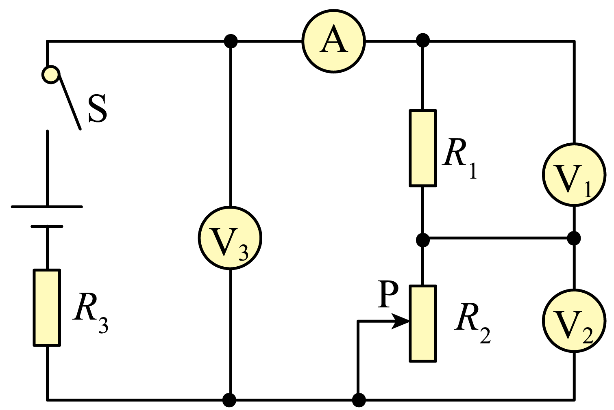

# Physics - 题目 687

**ID**: 55ebf92c243b4a4682603fa42af74b45
**年级**: Grade 9
**难度**: Medium-Hard
**题型**: Multiple-choice

## 题目
如图所示，R_{1}，R_{2}，是定值电阻，闭合开关S，当滑动变阻器R_{2}的滑片P向下移动时，四个电表A、V_{1}、V_{2}、V_{3}的示数变化量的绝对值分别用ΔI、ΔU_{1}、ΔU_{2}、ΔU_{3}表示（四个电表均为理想电表，电源电压保持不变）。​​​​​​​‌下列说法正确的是（      ）

## 解答

1. 由电路图可知，R_{1}、R_{2}、R_{3}串联，电流表测电路的电流，电压表V_{1}测R_{1}两端电压，电压表V_{2}测R_{2}两端电压，电压表V_{3}测R_{1}与R_{2}两端电压之和，当滑动变阻器的滑片P向下滑动时，滑动变阻器连入电路的阻值变大，由欧姆定律可得
2. $R{{}_{1}}=\frac {U{{}_{1}}}{I}$
3. 因R_{1}为定值电阻，阻值不变，则 $\frac {U{{}_{1}}}{I}$ 保持不变，即 $\frac {{\rm{Δ}}U{{}_{1}}}{{\rm{Δ}}I}$ 保持不变，同理有
4. $R{{}_{2}}=\frac {U{{}_{2}}}{I}$
5. 因滑动变阻器接入电路中的阻值变大，即R_{2}变大，故 $\frac {U{{}_{2}}}{I}$ 变大，由串联电路电压的规律可得，V_{2}示数变化量等于R_{1}、R_{3}的电压变化量（R_{1}、R_{3}串联的总电阻为R_{13}），即
6. ΔU_{2}=ΔU_{13}
7. 由欧姆定律可得
8. U_{13}=IR_{13}①
9. U′_{13}=I′R_{13}②
10. ① $-$ ②得
11. ΔU_{13}=U_{13}-U′_{13}=IR_{13}-I′R_{13}=(I-I′)R_{13}=ΔIR_{13}
12. 故可得
13. $\frac {{\rm{Δ}}U{{}_{13}}}{{\rm{Δ}}I}=R{{}_{13}}$
14. 即
15. $\frac {{\rm{Δ}}U{{}_{13}}}{{\rm{Δ}}I}=\frac {{\rm{Δ}}U{{}_{2}}}{{\rm{Δ}}I}=R{{}_{13}}$
16. 保持不变；由欧姆定律可得
17. $\frac {U{{}_{3}}}{I}=R{{}_{1}}+R{{}_{2}}$
18. 因R_{1}不变，R_{2}变大，故 $\frac {U{{}_{3}}}{I}$ 变大，由串联电路电压的规律可得，U_{3}的变化量等于R_{2}的电压变化量，即
19. ${\rm{Δ}}U{{}_{3}}={\rm{Δ}}U{{}_{R{{}_{2}}}}$
20. 所以
21. $\frac {{\rm{Δ}}U{{}_{R{{}_{2}}}}}{{\rm{Δ}}I}=R{{}_{3}}$
22. 即
23. $\frac {{\rm{Δ}}U{{}_{3}}}{{\rm{Δ}}I}=\frac {{\rm{Δ}}U{{}_{R{{}_{2}}}}}{{\rm{Δ}}I}=R{{}_{3}}$
24. 则 $\frac {{\rm{Δ}}U{{}_{3}}}{{\rm{Δ}}I}$ 保持不变，综上可知，ABD错误，C正确。
25. 故选C。

## 知识点

**中文**:
  - 电路的动态分析

**English**:
  - Dynamic Circuit Analysis

---
