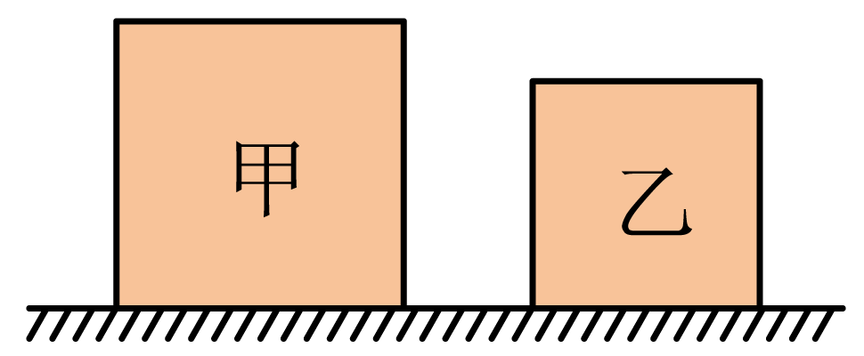

# Physics - 题目 748

**ID**: 5ad6bcb7786442ae9470598bb062c8a0
**年级**: Grade 9
**难度**: Medium-Hard
**题型**: Multiple-choice

## 题目
如图所示，甲、乙两个实心均匀正方体分别放在水平地面上，两个正方体的边长分别为h_{甲}和h_{乙}（h_{甲}>h_{乙}），它们对地面的压强相等。​​​​​​​‌若在两正方体的上部沿水平方向分别截去相同的质量，则剩余的压强p'_{甲}和p'_{乙}的大小关系是（      ）

## 解答

1. 甲、乙是两个实心均匀正方体，所以对地面的压强
2. p=ρ_{甲}gh_{甲}=ρ_{乙}gh_{乙}
3. 即有
4. $\frac {ρ{{}_{乙}}}{ρ{{}_{甲}}}=\frac {h{{}_{甲}}}{h{{}_{乙}}}$ ①
5. 因为h_{甲}>h_{乙}，所以ρ_{甲}<ρ_{乙}。由于截去的质量相同，所以
6. $Δm{{}_{甲}}=Δm{{}_{乙}}$
7. 即有
8. $ρ{{}_{甲}}S{{}_{甲}}Δh{{}_{甲}}=ρ{{}_{乙}}S{{}_{乙}}Δh{{}_{乙}}$ ②
9. 联合①②两式得
10. $\frac {{\rm{Δ}}h{{}_{甲}}}{{\rm{Δ}}h{{}_{乙}}}=\frac {ρ{{}_{乙}}S{{}_{乙}}}{ρ{{}_{甲}}S{{}_{甲}}}=\frac {h{{}_{甲}}S{{}_{乙}}}{h{{}_{乙}}S{{}_{甲}}}=\frac {h{{}_{甲}}h{{}_{乙}}{^{2}}}{h{{}_{乙}}h{{}_{甲}}{^{2}}}=\frac {h{{}_{乙}}}{h{{}_{甲}}}$
11. 因为h_{甲}>h_{乙}，所以 $\Delta h{{}_{甲}}<\Delta h{{}_{乙}}$ ，据p=ρgh知，截去部分的压强关系
12. $Δp{{}_{甲}}<Δp{{}_{乙}}$
13. 而剩余的压强
14. p'_{甲}=p-∆p_{甲}，p'_{乙}=p-∆p_{乙}
15. 所以有p'_{甲}>p'_{乙}。故A符合题意，BCD不符合题意。
16. 故选A。

## 知识点

**中文**:
  - 压强大小的比较

**English**:
  - Comparing Pressure

---
