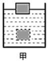
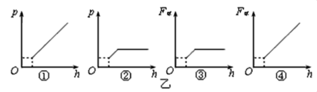

# Physics - 题目 1331

**ID**: 5e279aac84864f4dafbd2ff7ec2ade49
**年级**: Grade 9
**难度**: Medium-Hard
**题型**: Multiple-choice

## 题目
一物体（长方体）漂浮在液面上，如图（甲）所示．对物体施加力的作用，使物体下降至图中的虚线位置．已知物体的下表面到水面的高度为h，水对物体下表面的压强为p，物体受到的浮力为F_{浮}，p、F_{浮}与h的关系如图（乙）所示．其中正确的是​​​​​​​‌

## 解答

1. 液体内部压强随深度的增加而增大，所以物体下表面的压强图象应是逐渐升高的，图象①正确，②错误；浮力的大小与排开液体的体积成正比，当物体完全浸入水中后，其浮力大小将不再变化，故图象③正确，④错误，故本题答案为A.
2. 思路分析：液体内部压强随深度的增加而增大，所以物体下表面的压强图象应是逐渐升高的，图象①正确；浮力的大小与排开液体的体积成正比，当物体完全浸入水中后，其浮力大小将不再变化，故图象③正确．
3. 试题点评：本试题考查的是浮力和液体压强的知识．液体内部压强随深度的增加而增大，所以物体下表面的压强图象应是逐渐升高的，根据阿基米德原理可知浮力的大小与排开液体的体积成正比，当物体完全浸入水中后，其浮力大小将不再变化．

## 知识点

**中文**:
  - 浮力大小的计算
  - 液体压强的大小及其计算
  - 阿基米德原理的应用
  - 物体的浮沉条件及其应用

**English**:
  - Calculation of Buoyancy
  - Magnitude and Calculation of Liquid Pressure
  - Applications of Archimedes' Principle
  - Floating/Sinking Conditions and Applications

---
