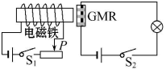

# Physics - 题目 2802

**ID**: 65d1647cedf54595b76a2297a686d517
**年级**: Grade 9
**难度**: Medium-Hard
**题型**: Multiple-choice

## 题目
法国科学家阿尔贝·费尔和德国科学家彼得·格林贝格尔由于巨磁电阻(GMR)效应而荣获2007年诺贝尔物理学奖。​​​​​​​‌如图4是研究巨磁电阻特性的原理示意图。实验发现，在闭合开关S_{1}、S_{2}且滑片P向右滑动的过程中，指示灯明显变暗，这说明（      ）

## 解答

1. A．根据右手螺旋定则可知电磁铁的左端为N极、右端为S极，故A项不符合题意；
2. B．指示灯变暗，说明通过灯泡的电流减小，故B项不符合题意；
3. C．闭合开关S_{1}、S_{2}且滑片P向右滑动的过程，通过电磁铁线圈的电流变小，电磁铁磁场减弱，而右边电路中的指示灯明显变暗，则说明右边电路的电流变小了，巨磁电阻的阻值变大，由此可知，巨磁电阻的阻值随磁场的减弱而增强，故C项合题意；
4. D．由上述分析可知巨磁电阻的阻值与磁场的强弱有关，故D项不符合题意。
5. 故选C。

## 知识点

**中文**:
  - 影响电磁铁磁性强弱的因素
  - 电路的动态分析

**English**:
  - Factors Affecting Electromagnet Strength
  - Dynamic Circuit Analysis

---
